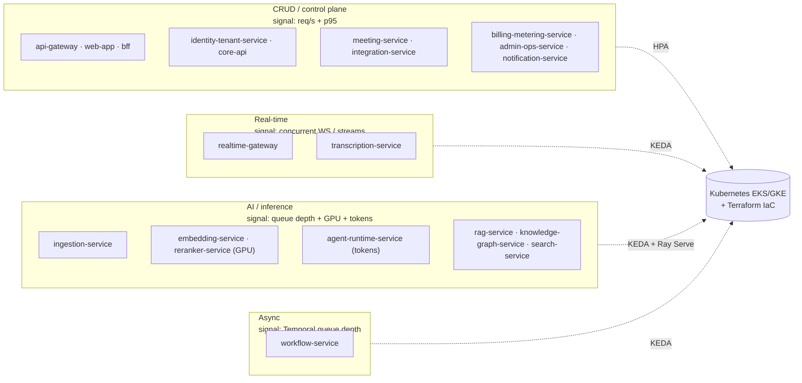

# Container Diagram (C4 L2)

The single-page, diagram-first C4 Level 2 view of NEXUS: every service from the canonical service catalog, every data store and backbone plane, and the synchronous-vs-asynchronous communication style on each edge.

## Related documents

- [Container Architecture (C4 L2) — full prose](../03-container-architecture.md) — the long-form container treatment this diagram companion summarizes.
- [System Context (C4 L1)](../02-system-context.md) — the level above: actors and external systems.
- [Service Catalog (canon)](../_canon/01-service-catalog.md) — the single naming authority for services and the "Owns data" mapping used here.
- [Canonical Data Model (canon)](../_canon/02-data-model.md) — entity/table names, stores, tenant keys.
- [Capacity & Scaling Math (canon)](../_canon/05-capacity-math.md) — frozen load numbers cited on edges.
- [Locked Tech & Architecture Decisions (canon)](../_canon/06-tech-decisions.md) — every locked technology choice.
- [Service Catalog & Bounded Contexts](../04-service-catalog.md) — per-service responsibility and failure modes.
- [Data Architecture](../05-data-architecture.md) — store partitioning, retention, DR.
- [Event-Driven Architecture](../07-event-architecture.md) — topics, Avro subjects, outbox/inbox, DLQs.

---

## 1. Scope

This is the **diagram-first** companion to [Container Architecture (C4 L2)](../03-container-architecture.md). It does not re-derive that document's prose; it delivers the master container picture in one diagram, a scaling-family cut, a binding legend, and the key flows. Every service, store, topic, and number is used **verbatim from the canon** — no new names are introduced. SaaS-scale additions are called out explicitly.

A "container" here is a separately deployable runtime unit: a NEXUS-owned service, a data store, the event broker, the workflow plane, or an external managed plane. The 20 NEXUS-owned services are exactly the [Service Catalog](../_canon/01-service-catalog.md) roster, grouped by their three scaling families plus the async tier.

### 1.1 Communication-style legend (binding)

This legend is binding for every diagram below and is held identical to [Container Architecture §1.1](../03-container-architecture.md).

| Style | Notation | Transport | When used |
| --- | --- | --- | --- |
| **Synchronous** | solid arrow `-->` labeled `REST` or `gRPC` | HTTPS (external), HTTP/1.1 or gRPC (internal mesh) | Request/response where the caller needs the answer now. |
| **Asynchronous** | solid arrow `-->` labeled with a **topic name** | Redpanda (Kafka API), Avro + Schema Registry, tenant-partitioned | Fire-and-forget, fan-out, decoupled inter-tier flow. At-least-once with idempotency. |
| **WebSocket** | bidirectional arrow `<-->` labeled `WSS` | WSS (Socket.io or raw WS) | Long-lived bidirectional streams: live captions, agent output, audio. |
| **Managed-plane call** | dashed arrow `-.->` | Provider SDK/API over HTTPS/WSS | Calls to Clerk, Deepgram, LiveKit, Stripe, Temporal Cloud, Anthropic. |

> [SaaS-scale adjustment] The PDF ran all inter-component calls in one in-process FastAPI app and named no services. This L2 view splits it into the 20 catalog services and standardizes the internal sync mesh on **gRPC** for the AI/inference and real-time tiers (tight p95 budgets — see [Capacity & Scaling Math §11](../_canon/05-capacity-math.md)), while `bff` and CRUD services expose REST. All external ingress is HTTPS/WSS through `api-gateway`.

---

## 2. Master container diagram

Every NEXUS-owned service from the [Service Catalog](../_canon/01-service-catalog.md) appears exactly once, grouped by scaling family. Each store is drawn next to its single owning service (per the catalog "Owns data" column). Async edges carry their canonical topic name; sync edges are labeled `REST`/`gRPC`; managed planes are dashed.

```mermaid
flowchart TB
  USER([User browser / mobile])

  subgraph Edge["Edge / client tier"]
    CDN["Cloudflare CDN + WAF<br/>(global rate limit)"]
    GW["api-gateway<br/>(TLS, WAF, JWT pre-validate, org_id)"]
    WEB["web-app<br/>(Next.js 14 App Router)"]
    BFF["bff<br/>(client aggregation)"]
  end

  subgraph CRUD["CRUD / control plane (scales on req/s)"]
    IDENT["identity-tenant-service"]
    CORE["core-api"]
    MEET["meeting-service"]
    INTEG["integration-service"]
    BILL["billing-metering-service"]
    ADMIN["admin-ops-service"]
    NOTIF["notification-service"]
  end

  subgraph RT["Real-time tier (scales on concurrent connections)"]
    RTGW["realtime-gateway"]
    TRANS["transcription-service"]
  end

  subgraph AI["AI / inference tier (scales on tokens, vectors, GPU)"]
    INGEST["ingestion-service"]
    EMB["embedding-service"]
    RERANK["reranker-service"]
    AGENT["agent-runtime-service"]
    RAG["rag-service"]
    KG["knowledge-graph-service"]
    SEARCH["search-service"]
  end

  subgraph WF["Async / orchestration"]
    FLOW["workflow-service<br/>(Temporal workers)"]
  end

  RP[["Redpanda<br/>(tenant-partitioned topics, Avro)"]]

  subgraph Stores["Data stores"]
    PG[("PostgreSQL (Supabase)<br/>+ Apache AGE nexus_knowledge<br/>RLS by org_id")]
    QD[("Qdrant Cloud<br/>per-tenant collections")]
    RD[("Redis (Upstash)<br/>namespaced nexus:org_id:*")]
    OBJ[("Object storage (S3)<br/>mytheus-recordings / -documents / -invoices")]
  end

  subgraph Managed["External managed planes"]
    CLERK(["Clerk<br/>(auth, SSO/SAML/SCIM)"])
    LIVEKIT(["LiveKit<br/>(SFU)"])
    DG(["Deepgram<br/>(ASR + diarization)"])
    STRIPE(["Stripe<br/>(billing)"])
    TMP(["Temporal Cloud"])
    LLM(["Anthropic<br/>(via LiteLLM)"])
    SLACK(["Slack / email<br/>(delivery channels)"])
  end

  %% ---- Edge ingress (sync + WS) ----
  USER -->|HTTPS| CDN
  CDN -->|HTTPS| GW
  USER <-->|WSS| RTGW
  GW -->|REST| BFF
  GW -.->|JWT verify| CLERK
  WEB -->|REST| BFF
  BFF -->|REST| IDENT
  BFF -->|REST| CORE
  BFF -->|REST| MEET
  BFF -->|REST| INTEG
  BFF -->|REST| BILL
  BFF -->|REST| ADMIN
  BFF -->|REST| RAG
  BFF -->|REST| SEARCH

  %% ---- CRUD-tier sync + stores ----
  IDENT -->|writes| PG
  CORE -->|writes| PG
  MEET -->|writes| PG
  INTEG -->|writes| PG
  BILL -->|writes| PG
  ADMIN -->|writes| PG
  IDENT -.->|SCIM / webhook| CLERK
  BILL -.->|subscriptions / webhook| STRIPE
  MEET -.->|room token / webhook| LIVEKIT
  IDENT -->|cache get_user_context| RD

  %% ---- Real-time tier ----
  MEET -->|LiveKit audio hook| TRANS
  TRANS -.->|audio WSS| DG
  TRANS -->|writes finals| PG
  TRANS -->|transcript-chunks| RP
  RTGW -->|pub/sub| RD

  %% ---- AI / inference tier ----
  INGEST -->|document-chunks| RP
  INGEST -->|writes| PG
  INGEST -->|source docs| OBJ
  RP -->|transcript-chunks| EMB
  RP -->|document-chunks| EMB
  RP -->|transcript-chunks| AGENT
  RP -->|document-chunks| AGENT
  RP -->|transcript-chunks| SEARCH
  EMB -->|upsert vectors| QD
  AGENT -->|agent-results| RP
  AGENT -->|agent-stream| RP
  AGENT -->|usage-events| RP
  AGENT <-->|agent-requests / agent-responses| RP
  AGENT -.->|tiered LLM| LLM
  AGENT -->|gRPC RAG query| RAG
  RAG -->|gRPC embed query| EMB
  RAG -->|gRPC rerank| RERANK
  RAG -->|gRPC graph query| KG
  RAG -->|gRPC FTS| SEARCH
  RAG -->|vector search| QD
  RAG -->|cache| RD
  RAG -.->|query expansion| LLM
  KG -->|Cypher| PG
  SEARCH -->|FTS index| PG

  %% ---- Confirmed-decision graph writes ----
  AGENT -->|agent-results| CORE
  CORE -->|decisions| RP
  CORE -->|actions| RP
  RP -->|decisions| KG
  RP -->|actions| KG

  %% ---- Async fan-out + workflows ----
  AGENT -->|agent-results / agent-stream| RTGW
  RP -->|agent-results / agent-stream| RTGW
  RP -->|notifications| NOTIF
  RP -->|usage-events| BILL
  BILL -->|billing-events| RP
  AGENT -->|notifications| RP
  INTEG -->|integration-events| RP
  RP -->|integration-events| INGEST
  RP -->|meeting-events / actions / billing-events| FLOW
  FLOW -.->|durable workflows| TMP
  FLOW -->|REST| CORE
  FLOW -->|REST| INTEG
  FLOW -->|notifications| RP
  NOTIF -.->|email / Slack DM| SLACK
  NOTIF <-->|in-app fan-out| RTGW
```

> [SaaS-scale adjustment] The topics `meeting-events`, `integration-events`, `usage-events`, `billing-events` (and the rest of the control-plane set in [Service Catalog §5](../_canon/01-service-catalog.md)) are SaaS additions; the PDF's nine data-plane topics (`transcript-chunks`, `document-chunks`, `agent-results`, `decisions`, `actions`, `notifications`, `agent-requests`, `agent-responses`, `agent-stream`) are carried verbatim. Per-tenant Qdrant collections, namespaced Redis (`nexus:{org_id}:*`), org-partitioned `nexus_knowledge`, and RLS-by-`org_id` are SaaS isolation additions.

---

## 3. Scaling-family cut

The same containers, grouped only by **autoscaler signal** — the reason the modular monolith is cut where it is. Each family bills as its own cost center (see [Capacity & Scaling Math §10](../_canon/05-capacity-math.md)).

> [SaaS-scale adjustment] The PDF coupled CPU/GPU-bound inference (BGE-small embeddings, BGE-reranker) and per-chunk LLM agent work onto the single FastAPI tier. Here `embedding-service` and `reranker-service` are dedicated GPU/Ray Serve services and `agent-runtime-service` autoscales on token throughput — all **off the API tier** — so the inference cost center (94% of variable cost, per [Capacity & Scaling Math §10.1](../_canon/05-capacity-math.md)) scales and bills independently. This is the architectural fix for PDF risks R4 (LLM cost spiral) and R5 (agent latency budget).

---

## 4. Key flows

- **Live transcription → embeddings & agents.** `meeting-service` bridges the LiveKit server-side audio hook to `transcription-service`, which proxies audio to Deepgram (key stays server-side), persists **only finals** to `transcript_chunks`, and emits the `transcript-chunks` topic. That topic fans out asynchronously to `embedding-service` (consume → split → embed batch 32 → upsert per-tenant Qdrant), `agent-runtime-service` (windowed batching, never per raw chunk), and `search-service` (FTS index). At capacity this is 360 `transcript-chunks` per meeting and ~525 embeddings/sec peak ([T2](../_canon/05-capacity-math.md), [EM2](../_canon/05-capacity-math.md)).

- **Agent intelligence → sidebar.** `agent-runtime-service` hosts the seven LangGraph agents (PersonalListenerAgent, DecisionAgent, ActionAgent, QuestionAgent, ContextGapAgent, ProactiveAgent, MeetingAgent), routes tiered LLM calls via LiteLLM (Haiku → Sonnet → Opus), and emits `agent-results` and `agent-stream` (token deltas). `realtime-gateway` consumes these and fans them to the agent sidebar over `WSS`, holding the p50 < 2s / p95 < 4s end-to-end budget.

- **Confirmed decisions → knowledge graph.** Agents never write the graph directly. On user confirmation `core-api` emits `decisions`/`actions`; `knowledge-graph-service` consumes them and creates the `PRODUCED` / `ASSIGNED_TO` edges in `nexus_knowledge`. No silent commits — matching the PDF confirmation rule.

- **Multi-agent context fill.** `ContextGapAgent` (in `agent-runtime-service`) requests context from peer agents over `agent-requests` and receives `agent-responses` (correlation IDs, deadline, fall-through to RAG → silent). This is the bus loop `agent-runtime-service <--> Redpanda`, A2A-authorized deny-by-default within one `org_id`.

- **RAG retrieval (sync mesh).** `rag-service` runs expand → retrieve → rerank → assemble → cite, calling `embedding-service`, `reranker-service`, `knowledge-graph-service`, and `search-service` over **gRPC** (warm p95 < 500 ms), fusing Qdrant + Postgres FTS + AGE topic-relations by RRF, and caching answers in Redis (10-min TTL).

- **Metering & billing loop.** `agent-runtime-service` and `rag-service` emit `usage-events`; `billing-metering-service` aggregates them, enforces per-tenant token budgets/hard quotas, and emits `billing-events` that drive `workflow-service` dunning sagas on Temporal Cloud — the SaaS monetization path absent from the PDF.

---

## 5. Container inventory (cross-reference)

Every container in the master diagram, its tier, and its single owned store (per the [Service Catalog](../_canon/01-service-catalog.md) "Owns data" column).

| Container | Tier | Owns (writes) |
| --- | --- | --- |
| `api-gateway`, `web-app`, `bff` | Edge / client | none (stateless) |
| `identity-tenant-service` | CRUD | `users`, `organizations`, `tenants`, RBAC/SSO/SCIM state (Postgres) |
| `core-api` | CRUD | `meetings`, `teams`, `departments`, `meeting_participants`, `meeting_speakers`, `worklogs`, `decisions`, `action_items`, `agent_suggestions`, `chat_messages`, `agent_collaborations` (Postgres) |
| `meeting-service` | CRUD | `meeting_rooms` (LiveKit map) |
| `integration-service` | CRUD | `integration_links`, OAuth tokens/cursors |
| `billing-metering-service` | CRUD | `subscriptions`, `seats`, `plans`, `usage_aggregates`, `quotas`, `invoices` |
| `admin-ops-service` | CRUD | feature flags, ops audit log |
| `notification-service` | CRUD | `notification_log`, channel prefs |
| `realtime-gateway` | Real-time | none (ephemeral; Redis pub/sub) |
| `transcription-service` | Real-time | `transcript_chunks` (Postgres) |
| `ingestion-service` | AI / inference | `document_chunks`, `document_elements` |
| `embedding-service` | AI / inference | none (writes Qdrant vectors) |
| `reranker-service` | AI / inference | none |
| `agent-runtime-service` | AI / inference | none (writes via `core-api` outbox) |
| `rag-service` | AI / inference | none (Redis answer cache only) |
| `knowledge-graph-service` | AI / inference | AGE graph `nexus_knowledge` (org-partitioned) |
| `search-service` | AI / inference | FTS indexes / tsvector materializations |
| `workflow-service` | Async | none (Temporal owns workflow state) |

Backbone & external planes drawn: **Redpanda** (event broker, tenant-partitioned), **Temporal Cloud** (durable workflows), **Clerk** (auth), **LiveKit** (SFU), **Deepgram** (ASR), **Stripe** (billing), **Anthropic via LiteLLM** (LLM). For per-service responsibility and failure modes see [Service Catalog & Bounded Contexts](../04-service-catalog.md); for the full prose container treatment see [Container Architecture (C4 L2)](../03-container-architecture.md).
