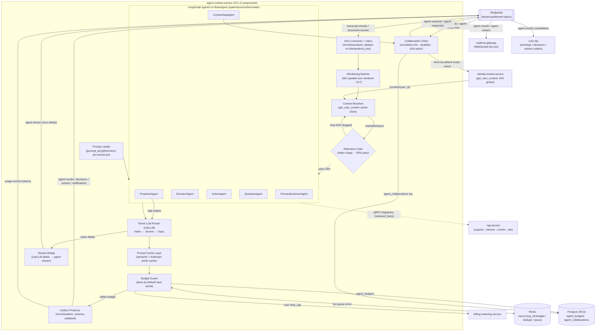

# Agent Runtime Components (C4 L3)

A C4 Level 3 component view of the internals of `agent-runtime-service`: the LangGraph `BaseAgent` lifecycle, the six agents, the relevance gate, the windowing batcher, the tiered LLM router, the versioned prompt loader, and the collaboration client.

## Related documents

- [AI Agent Architecture](../08-ai-agent-architecture.md) — the authoritative narrative for the six agents, `BaseAgent`/`AgentState`, the cost-controlled pipeline, and the collaboration protocol. This diagram doc decomposes that service into components.
- [Container Architecture (C4 L2)](../03-container-architecture.md) — the L2 container view that places `agent-runtime-service` in the AI/inference tier.
- [Service Catalog](../04-service-catalog.md) — the canonical service table, event ownership, and scaling families.
- [Event Architecture](../07-event-architecture.md) — Avro schemas for `transcript-chunks`, `agent-results`, `agent-requests`, `agent-responses`, `agent-stream`, and outbox/inbox delivery.
- [RAG Pipeline & Inference Serving](../09-rag-and-inference-serving.md) — `rag-service`, the embedding/reranker tier, and LiteLLM tiered routing internals.
- [Data Architecture](../05-data-architecture.md) — `worklogs` / `decisions` / `action_items` / `agent_collaborations` / `agent_budgets` ownership.
- [Service Catalog (canon)](../_canon/01-service-catalog.md) · [Capacity & Scaling Math (canon)](../_canon/05-capacity-math.md) · [Locked Tech Decisions (canon)](../_canon/06-tech-decisions.md) — frozen names and numbers cited here.

> [SaaS-scale adjustment] The PDF placed all six agents in-process inside a single FastAPI app, invoked once per raw `transcript_chunks` row. This view decomposes a dedicated `agent-runtime-service` (AI/inference scaling family, autoscaled on token throughput + chunk backlog) whose internal components implement windowed batching, relevance pre-gating, tiered routing, and deny-by-default collaboration authorization. The six agent names, `BaseAgent`/`AgentState`, `get_user_context`, the confidence thresholds, the `ContextGapAgent` fallback chain, and all topic names are carried over verbatim.

---

## 1. Scope

This document is a **C4 Level 3 (component) decomposition of exactly one container**: `agent-runtime-service`. It does not re-derive the cost model (cite [Capacity §8](../_canon/05-capacity-math.md)) or re-specify the agent behaviors (see [AI Agent Architecture](../08-ai-agent-architecture.md)). It answers one question: *what are the named components inside the service, and how does a `transcript-chunks` message flow through them to an `agent-results` / `agent-stream` output?*

The container being decomposed sits in the AI/inference scaling family and is a distinct cost center ([Service Catalog §4](../_canon/01-service-catalog.md)):

| Property | Value | Source |
|---|---|---|
| Container | `agent-runtime-service` | [Service Catalog (canon)](../_canon/01-service-catalog.md) |
| Runtime | FastAPI (Python 3.11+) + LangGraph | [Locked Tech §2.6](../_canon/06-tech-decisions.md) |
| Consumes | `transcript-chunks`, `document-chunks`, `agent-requests`, `agent-responses` | [Service Catalog (canon)](../_canon/01-service-catalog.md) |
| Produces | `agent-results`, `decisions`, `actions`, `agent-requests`, `agent-responses`, `agent-stream`, `notifications`, `usage-events` | [Service Catalog (canon)](../_canon/01-service-catalog.md) |
| Autoscaler signal | token throughput + chunk backlog (KEDA) | [Service Catalog §4](../_canon/01-service-catalog.md) |
| Peak load | `L9` ≈ 8,930 LLM calls/sec; `L7` ≈ 5.79B calls/month | [Capacity §8.2](../_canon/05-capacity-math.md) |
| Latency budget | agent end-to-end p50 < 2s / p95 < 4s; collaboration round-trip p95 < 1.5s | [Capacity §11.1](../_canon/05-capacity-math.md) |

---

## 2. The component diagram

> [SaaS-scale adjustment] The Inbox dedupe on `CONS`, the `BUDGET` guard, the per-tenant prompt pin in `PLOAD`, the A2A authorization check in `COLLAB`, and the `usage-events` emission are all SaaS-scale additions. The PDF had a single in-process agent loop with at-most-once-ish consume, per-user budgets, no tenant authz on collaboration, and no metering. Names of the six agents, `get_user_context`, and the topics are unchanged.

---

## 3. Component responsibilities

Each box in §2 is named once here. No other doc may introduce an alternative name for these components.

| Component | Responsibility | Reads / writes | Canon anchor |
|---|---|---|---|
| Avro Consumer + Inbox | Base consumer (AvroDeserializer, offset commit, retry). Dedupes on `idempotency_key` via Redis `nexus:{org_id}:dedupe:{topic}:{key}` inbox; poison messages → per-topic DLQ. | Consumes `transcript-chunks`, `document-chunks` | [Locked Tech §2.4](../_canon/06-tech-decisions.md) |
| Windowing Batcher | Merges Deepgram utterances by speaker turn into **30s windows** (`A17`); 90 windows/meeting vs 360 raw `transcript_chunks` (`T2`). Builds `AgentState.chunk` (a `TranscriptWindow`, not a raw row). | In-memory window buffers | [Capacity §8.2](../_canon/05-capacity-math.md) |
| Context Resolver | Calls `get_user_context(user_id)` → role/skills/team/recent meetings/topics; Redis-cached `nexus:{org_id}:user_ctx:{user_id}` (TTL 5 min). Populates `AgentState.context`. | `identity-tenant-service` `/context/{user_id}` | [Locked Tech §2.6](../_canon/06-tech-decisions.md) |
| Relevance Gate | One cheap **Haiku** triage call per window per participant; ~35% pass (gate-pass 0.35). Failing 65% are logged and dropped — no extraction call made. Distinct from confidence surfacing. | Calls Tiered LLM Router (Haiku) | [Capacity §8.2](../_canon/05-capacity-math.md) |
| LangGraph agents (×6) | `PersonalListenerAgent`, `DecisionAgent`, `ActionAgent`, `QuestionAgent`, `ContextGapAgent`, `ProactiveAgent`, each a LangGraph graph on shared `BaseAgent`. | Produce `AgentResult` | [Locked Tech §2.6](../_canon/06-tech-decisions.md) |
| Prompt Loader | Resolves `{prompt_key}@{version}` per tenant (`org_id` pin overrides global default) for staged rollout. Version-controlled templates. | Reads template store | [AI Agent Architecture §3.3](../08-ai-agent-architecture.md) |
| Tiered LLM Router | LiteLLM: Haiku triage/score, Sonnet extract, Opus high-stakes. Per-user rate limits, token tracking. Picks the cheapest model that can do the job. | Anthropic via LiteLLM | [Locked Tech §2.5](../_canon/06-tech-decisions.md) |
| Prompt Cache Layer | Anthropic prefix cache for stable prompt prefixes (role taxonomy, system prompt, prior-window context) + semantic cache for near-duplicate windows. | Applied after tiering | [AI Agent Architecture §4.1](../08-ai-agent-architecture.md) |
| Budget Guard | Checks `agent_budgets` mirrored hot in Redis `nexus:{org_id}:budget:{period}`. 80%/95% alerts; at `hard_cap` denies (`state` → `blocked`), deny-by-default. | `agent_budgets` (PG) + Redis; emits `usage-events`, `billing-events`, `notifications` | [Data Model §2.2](../_canon/02-data-model.md) |
| Collaboration Client | Implements `ContextGapAgent` A2A over `agent-requests`/`agent-responses` (correlation IDs, deadline, fall-through). Enforces deny-by-default org/role scope; logs `agent_collaborations`. | Produces/consumes `agent-requests`/`agent-responses`; `identity-tenant-service` grants; `agent_collaborations` (PG) | [Locked Tech §2.6](../_canon/06-tech-decisions.md) |
| Stream Bridge | Bridges LiteLLM streamed tokens → `agent-stream` Avro deltas → `realtime-gateway` → UI; feeds the per-user priority queue. | Produces `agent-stream` | [Capacity §6](../_canon/05-capacity-math.md) |
| Outbox Producer | Single sanctioned producer path (confluent-kafka-python + AvroSerializer, schema-validated). Transactional outbox; emits candidates, never silent commits. | Produces `agent-results`, `decisions`, `actions`, `notifications`, `usage-events` | [Locked Tech §2.4](../_canon/06-tech-decisions.md) |

---

## 4. Legend

| Symbol | Meaning |
|---|---|
| Solid arrow | In-process or synchronous call between components |
| Solid arrow labelled with a topic name | Avro event published to / consumed from Redpanda (at-least-once, tenant-partitioned) |
| Dashed arrow | Synchronous internal gRPC call to another service (e.g. `rag-service`) |
| `{ }` rhombus (`GATE`, `BUDGET`) | A decision/gating component that may drop or deny flow |
| `[[ ]]` (`RP`) | The Redpanda event backbone (external to the container) |
| `[( )]` (`REDIS`, `PG`) | Data stores read/written by the container's components |
| `subgraph ARS` | The container boundary of `agent-runtime-service`; everything inside is a C4 L3 component |

---

## 5. Key flows

- **Per-window, not per-chunk (R4 fix).** A `transcript-chunks` message is deduped by the Inbox, then the **Windowing Batcher** collapses 360 raw chunks/meeting into 90 30-second windows (`A17`). The agents are invoked on windows — this is the single most load-bearing lever defeating the R4 cost bomb (naive `N2` = 41.5B calls/month → controlled `L7` ≈ 5.79B, an `L10` = 86% reduction; [Capacity §8](../_canon/05-capacity-math.md)).

- **Two gates, two scores.** The **Relevance Gate** (Haiku, ~35% pass) decides *does this window matter to this user* and drops 65% before any extraction call. Separately, the surfacing **confidence thresholds** (`>0.7` surface · `0.4–0.7` silent log to `worklogs` · `<0.4` drop) decide whether an `AgentResult` reaches the sidebar. These are distinct scores on `AgentState` (`relevance_score` vs `confidence`).

- **Deny-by-default budget and authz.** The **Budget Guard** fail-closes against the per-tenant `agent_budgets` hard cap (mirrored in Redis for fast checks), emitting `usage-events` to `billing-metering-service`; the **Collaboration Client** fail-closes against `identity-tenant-service` org/role scope so an `agent-requests` message can never cross a tenant boundary. Both are SaaS-scale additions over the PDF's free-for-all.

- **No silent commits.** Decisions and actions leave the service only as **candidates** on `agent-results`. The user confirms via `core-api`, and `core-api` (not this service) emits the confirmed `decisions`/`actions` that create AGE `PRODUCED` / `ASSIGNED_TO` edges in `nexus_knowledge`. The agent tier never writes Postgres directly.

- **Streaming on the latency budget.** The **Stream Bridge** pushes LiteLLM token deltas onto `agent-stream` → `realtime-gateway` so the sidebar fills incrementally within the p50 < 2s / p95 < 4s end-to-end budget (`R5`); the per-user priority queue lets urgent alerts pre-empt notes.

- **Collaboration round-trip.** `ContextGapAgent` routes through the Collaboration Client over `agent-requests`/`agent-responses` with correlation IDs and a deadline, following the fall-through chain peer-agents → related-meeting agents → RAG → silent, all within the p95 < 1.5s round-trip budget; every hop is logged to `agent_collaborations`.
