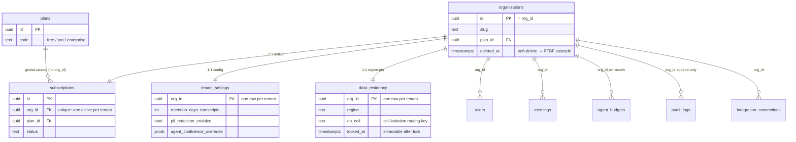
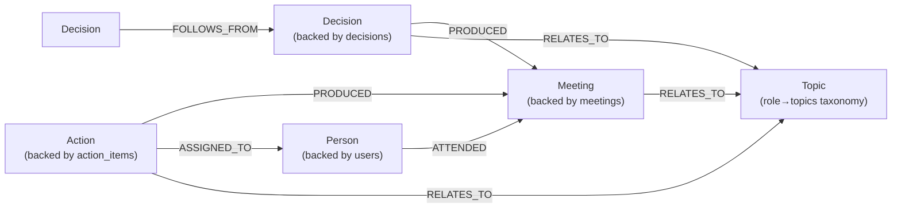
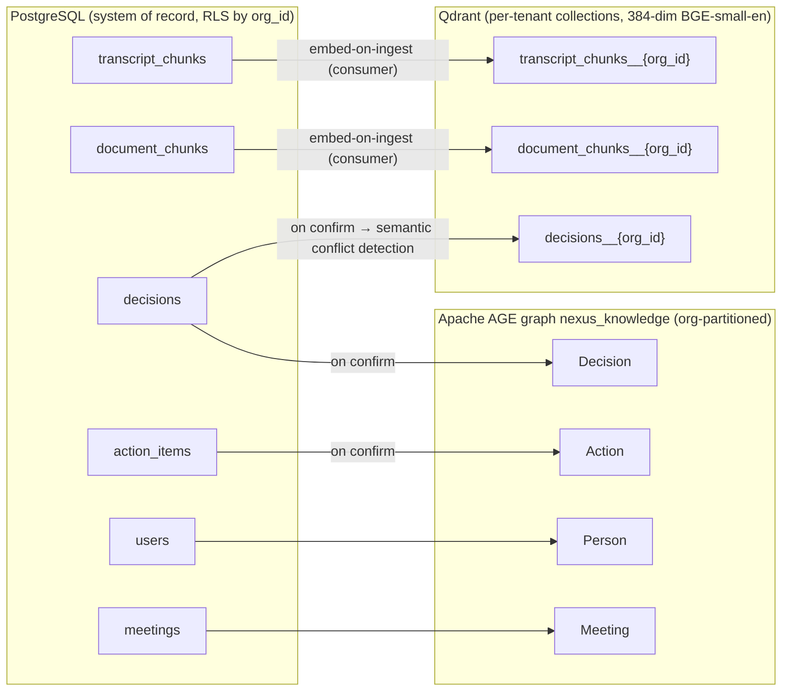

# Entity Relationship Diagram

A single, diagram-first view of every NEXUS data entity — PDF-original and SaaS-added — with tenant keys, cardinalities, owning services, and the cross-store projections that hang off the relational core.

## Related documents

- [Data Model (canon)](../_canon/02-data-model.md) — the frozen naming authority for every entity, column, and store.
- [Data Architecture](../05-data-architecture.md) — store selection, RLS policies, partitioning, retention, backups/PITR.
- [Service Catalog (canon)](../_canon/01-service-catalog.md) — owning services and data-ownership boundaries.
- [Multi-Tenancy](../06-multi-tenancy.md) — pooled + RLS for the long tail, cell isolation for enterprise, `org_id` injection.
- [Event Architecture](../07-event-architecture.md) — Redpanda topics, Avro subjects, outbox/inbox, idempotency, DLQs.
- [Capacity & Scaling Math (canon)](../_canon/05-capacity-math.md) — the frozen load/stock numbers this diagram annotates.
- [Tech Decisions (canon)](../_canon/06-tech-decisions.md) — locked store and naming decisions.

---

## 1. Purpose and scope

This document is the **picture** of the data model defined in the [Data Model canon](../_canon/02-data-model.md). It does not redefine entities or restate retention prose — that is owned by [Data Architecture](../05-data-architecture.md). It exists so an engineer can see, in one ERD, how all twenty-six canonical entities relate, where the tenant key lives, and how the relational rows project into the Qdrant vector store and the Apache AGE graph `nexus_knowledge`.

Every name below is verbatim from canon. No synonyms, no abbreviations, no invented tables.

> [SaaS-scale adjustment] The PDF had no `org_id` and no billing/compliance/integration/budget entities. Ten entities in the master ERD (§3) are wholly SaaS-added, and every tenant-scoped PDF table gains an `org_id UUID` tenant key. Both facts are called out in §3 and §4.

### 1.1 Mermaid convention for array columns

PostgreSQL array types (`skills text[]`, `source_chunk_ids uuid[]`) are not valid Mermaid `erDiagram` attribute types — the bracket pair breaks the parser. Throughout this document those columns render as `text_array` / `uuid_array`. This is a **rendering convention only**; the physical column types are `text[]` and `uuid[]` exactly as defined in [the data-model canon](../_canon/02-data-model.md). This matches the convention already used in [Data Architecture §2](../05-data-architecture.md).

---

## 2. The twenty-six canonical entities

The complete entity inventory the master ERD must cover. PDF-original first (names carried verbatim), then SaaS additions.

| # | Entity | Origin | Owning service | Tenant key | Store |
|---|--------|--------|----------------|------------|-------|
| 1 | `organizations` | PDF | identity-service | tenant **root** (`id` = `org_id`) | Postgres |
| 2 | `users` | PDF | identity-service | `org_id` | Postgres |
| 3 | `teams` | PDF | identity-service | `org_id` | Postgres |
| 4 | `team_members` | PDF | identity-service | `org_id` (denormalized) | Postgres |
| 5 | `departments` | PDF | identity-service | `org_id` | Postgres |
| 6 | `meetings` | PDF | meeting-service | `org_id` | Postgres |
| 7 | `meeting_participants` | PDF | meeting-service | `org_id` | Postgres |
| 8 | `transcript_chunks` | PDF | transcription-service | `org_id` | Postgres (+ Qdrant projection) |
| 9 | `meeting_speakers` | PDF | transcription-service | `org_id` | Postgres |
| 10 | `worklogs` | PDF | agent-service | `org_id` | Postgres |
| 11 | `decisions` | PDF | agent-service | `org_id` | Postgres (+ AGE + Qdrant) |
| 12 | `action_items` | PDF | agent-service | `org_id` | Postgres (+ AGE) |
| 13 | `agent_suggestions` | PDF | agent-service | `org_id` | Postgres |
| 14 | `agent_collaborations` | PDF | agent-service | `org_id` | Postgres |
| 15 | `chat_messages` | PDF | meeting-service | `org_id` | Postgres |
| 16 | `document_chunks` | PDF | rag-service | `org_id` | Postgres (+ Qdrant projection) |
| 17 | `plans` | SaaS-add | billing-service | none (global catalog) | Postgres |
| 18 | `subscriptions` | SaaS-add | billing-service | `org_id` | Postgres |
| 19 | `usage_events` | SaaS-add | billing-service | `org_id` | Postgres |
| 20 | `invoices` | SaaS-add | billing-service | `org_id` | Postgres |
| 21 | `audit_logs` | SaaS-add | audit-service | `org_id` | Postgres (append-only) |
| 22 | `integration_connections` | SaaS-add | integration-service | `org_id` | Postgres |
| 23 | `oauth_tokens` | SaaS-add | integration-service | `org_id` | Postgres (encrypted) |
| 24 | `tenant_settings` | SaaS-add | tenant-service | `org_id` (PK) | Postgres |
| 25 | `data_residency` | SaaS-add | tenant-service | `org_id` (PK) | Postgres |
| 26 | `agent_budgets` | SaaS-add | budget-service | `org_id` | Postgres |

> [SaaS-scale adjustment] Owning-service names follow the [data-model canon §1.1](../_canon/02-data-model.md) service-ownership map. The [Service Catalog](../_canon/01-service-catalog.md) consolidates several of these into deployables for the early modular monolith (`identity-service` + `tenant-service` → `identity-tenant-service`; `meeting-service`/`agent-service` data reads served by `core-api`; `billing-service` → `billing-metering-service`). Data ownership — who *writes* a table — is unchanged either way.

---

## 3. Master entity relationship diagram (all canon entities)

Every entity, its primary/foreign keys, the tenant key (`org_id`), and the relationships that bind the model. The `organizations` table is the tenant root: its `id` **is** the `org_id` carried by every other tenant-scoped row.

```mermaid
erDiagram
  %% ---- Core domain (PDF-original) ----
  organizations ||--o{ users : "employs"
  organizations ||--o{ departments : "owns"
  departments ||--o{ departments : "parent of"
  departments ||--o{ teams : "contains"
  teams ||--o{ team_members : "has"
  users ||--o{ team_members : "belongs to"
  organizations ||--o{ meetings : "hosts"
  meetings ||--o{ meeting_participants : "includes"
  users ||--o{ meeting_participants : "attends"
  meetings ||--o{ transcript_chunks : "produces"
  meetings ||--o{ meeting_speakers : "diarizes"
  users ||--o{ meeting_speakers : "mapped to"
  meetings ||--o{ chat_messages : "carries"
  users ||--o{ chat_messages : "posts"
  meetings ||--o{ worklogs : "yields"
  users ||--o{ worklogs : "owns"
  meetings ||--o{ decisions : "produces"
  meetings ||--o{ action_items : "produces"
  users ||--o{ action_items : "assigned"
  users ||--o{ agent_suggestions : "receives"
  meetings ||--o{ agent_suggestions : "context for"
  organizations ||--o{ agent_collaborations : "logs"
  organizations ||--o{ document_chunks : "stores"

  %% ---- SaaS-added: billing & metering ----
  plans ||--o{ subscriptions : "priced by"
  organizations ||--|| subscriptions : "has active"
  organizations ||--o{ usage_events : "emits"
  organizations ||--o{ invoices : "billed via"
  subscriptions ||--o{ invoices : "generates"
  organizations ||--o{ agent_budgets : "scoped per month"

  %% ---- SaaS-added: compliance, settings, integrations ----
  organizations ||--|| tenant_settings : "configures"
  organizations ||--|| data_residency : "pinned to region"
  organizations ||--o{ integration_connections : "installs"
  integration_connections ||--o{ oauth_tokens : "secured by"
  organizations ||--o{ audit_logs : "records"
  users ||--o{ audit_logs : "acts in"

  organizations {
    uuid id PK "= org_id (tenant root)"
    text name
    text slug
    uuid plan_id FK
    timestamptz created_at
    timestamptz deleted_at
  }
  users {
    uuid id PK
    uuid org_id FK
    text clerk_user_id
    text email
    text role
    text_array skills
    text bio
    text avatar_url
  }
  teams {
    uuid id PK
    uuid org_id FK
    text name
    uuid department_id FK
  }
  team_members {
    uuid team_id PK
    uuid user_id PK
    uuid org_id FK
    text role
  }
  departments {
    uuid id PK
    uuid org_id FK
    text name
    uuid parent_id FK
  }
  meetings {
    uuid id PK
    uuid org_id FK
    text title
    timestamptz scheduled_start
    timestamptz scheduled_end
    text livekit_room
    text status
    uuid created_by FK
  }
  meeting_participants {
    uuid meeting_id PK
    uuid user_id PK
    uuid org_id FK
    text role_in_meeting
  }
  transcript_chunks {
    uuid id PK
    uuid org_id FK
    uuid meeting_id FK
    text speaker_id
    int start_ms
    int end_ms
    text text
    bool is_final
    float confidence
  }
  meeting_speakers {
    uuid id PK
    uuid org_id FK
    uuid meeting_id FK
    text speaker_id
    uuid user_id FK
    float confidence
    text assignment
  }
  worklogs {
    uuid id PK
    uuid org_id FK
    uuid meeting_id FK
    uuid user_id FK
    text content
    float relevance_score
    bool created_by_agent
    uuid_array source_chunk_ids
  }
  decisions {
    uuid id PK
    uuid org_id FK
    uuid meeting_id FK
    text content
    text rationale
    float confidence
    text status
    uuid confirmed_by FK
  }
  action_items {
    uuid id PK
    uuid org_id FK
    uuid meeting_id FK
    text content
    uuid assignee_id FK
    date due_date
    float confidence
    text status
  }
  agent_suggestions {
    uuid id PK
    uuid org_id FK
    uuid user_id FK
    uuid meeting_id FK
    text question
    int priority
    text status
  }
  agent_collaborations {
    uuid id PK
    uuid org_id FK
    uuid requester FK
    uuid responder FK
    text query
    text result
    bool success
    int latency
  }
  chat_messages {
    uuid id PK
    uuid org_id FK
    uuid meeting_id FK
    uuid user_id FK
    text content
    timestamptz created_at
  }
  document_chunks {
    uuid id PK
    uuid org_id FK
    uuid document_id
    text element_id
    text element_type
    text text
    int position
  }
  plans {
    uuid id PK
    text code
    text name
    int seat_price_cents
    int included_meeting_minutes
    bigint included_agent_tokens
    jsonb features
  }
  subscriptions {
    uuid id PK
    uuid org_id FK
    uuid plan_id FK
    text stripe_subscription_id
    int seats
    text status
    timestamptz current_period_start
    timestamptz current_period_end
    timestamptz trial_ends_at
  }
  usage_events {
    uuid id PK
    uuid org_id FK
    uuid user_id FK
    text event_type
    numeric quantity
    timestamptz occurred_at
    text idempotency_key
  }
  invoices {
    uuid id PK
    uuid org_id FK
    text stripe_invoice_id
    timestamptz period_start
    timestamptz period_end
    int amount_due_cents
    int tax_cents
    text status
    text pdf_url
  }
  audit_logs {
    uuid id PK
    uuid org_id FK
    uuid actor_id
    text actor_type
    text action
    text target_type
    uuid target_id
    jsonb metadata
    text ip
    timestamptz occurred_at
  }
  integration_connections {
    uuid id PK
    uuid org_id FK
    text provider
    text external_account_id
    text status
    text_array scopes
    uuid installed_by FK
  }
  oauth_tokens {
    uuid id PK
    uuid org_id FK
    uuid connection_id FK
    text access_token_enc
    text refresh_token_enc
    timestamptz expires_at
    int token_version
  }
  tenant_settings {
    uuid org_id PK
    text default_locale
    jsonb agent_confidence_overrides
    int retention_days_transcripts
    int retention_days_worklogs
    bool pii_redaction_enabled
    jsonb sso_config
  }
  data_residency {
    uuid org_id PK
    text region
    text db_cell
    text qdrant_region
    text object_bucket_region
    timestamptz locked_at
  }
  agent_budgets {
    uuid id PK
    uuid org_id FK
    text period
    bigint token_quota
    bigint tokens_consumed
    bigint hard_cap
    bool alert_80_sent
    bool alert_95_sent
    text state
  }
```

> [SaaS-scale adjustment] The ten entities `plans`, `subscriptions`, `usage_events`, `invoices`, `audit_logs`, `integration_connections`, `oauth_tokens`, `tenant_settings`, `data_residency`, and `agent_budgets` are wholly new vs the PDF — they turn NEXUS into a multi-tenant commercial SaaS (billing, metering, compliance, integration credentials, per-tenant token budgets). `plans` is the only entity with **no** `org_id`: it is a global catalog priced against by every tenant's `subscriptions`. `tenant_settings`, `data_residency`, and `subscriptions` are strict 1:1 with `organizations` (one row per tenant), shown as `||--||`.

### 3.1 Legend

| Symbol / token | Meaning |
|----------------|---------|
| `\|\|--o{` | one-to-many (one parent row → zero-or-more child rows) |
| `\|\|--\|\|` | one-to-one (exactly one child per parent — the per-tenant singletons) |
| `PK` | primary key. Two `PK` lines on one entity = composite PK (`team_members`, `meeting_participants`). |
| `FK` | foreign key |
| `org_id` | the tenant key. Present on every tenant-scoped row; RLS-filtered by `current_setting('app.current_org')`. `organizations.id` **is** the `org_id`. |
| `text_array` / `uuid_array` | Mermaid-safe rendering of the physical `text[]` / `uuid[]` columns (see §1.1). |
| `_enc` suffix | envelope-encrypted at rest (per-tenant KMS data key); never returned by any API. |

### 3.2 Key flows captured by the ERD

- **Tenant fan-out.** `organizations` is the root of every relationship: `id = org_id` propagates to all 24 tenant-scoped tables as the RLS key, and to the three per-tenant singletons (`tenant_settings`, `data_residency`, `subscriptions`) as a 1:1 link. The long tail is pooled + RLS; large/enterprise tenants are cell-isolated via `data_residency.db_cell`. See [Multi-Tenancy](../06-multi-tenancy.md).
- **Meeting → intelligence chain.** A `meetings` row fans out to `meeting_participants`, `transcript_chunks` (only Deepgram **finals**, indexed on `(meeting_id, start_ms)`), `meeting_speakers` (diarized `speaker_id` → `user_id`, manual-authoritative + confidence-scored suggestion per PDF R7), then to the agent outputs `worklogs`, `decisions`, `action_items`, and `agent_suggestions`. This is the spine the six LangGraph agents write through. See [AI Agent Architecture](../08-ai-agent-architecture.md).
- **Confirmation gate → graph + vectors.** `decisions` and `action_items` are written by DecisionAgent/ActionAgent but only **on user confirmation** do they project into AGE `nexus_knowledge` (`Decision`/`Action`→`Meeting` `PRODUCED`, `Action`→`Person` `ASSIGNED_TO`) and into the `decisions` Qdrant collection. No silent commits — the ERD's `status`/`confirmed_by` columns are that gate. See §5.
- **Billing & metering loop.** `usage_events` (append-only, `idempotency_key`-deduped) aggregates into `invoices`; `subscriptions` references the global `plans` catalog; `agent_budgets` enforces per-tenant monthly token quotas (R4 cost control). See [SaaS Business Architecture](../18-saas-business-architecture.md) and [Capacity Math §8](../_canon/05-capacity-math.md).
- **Compliance & integration edges.** `audit_logs` is append-only and references both `organizations` and the acting `users`; `integration_connections` (Calendar/Slack/Jira/Linear, guardrail R8) secures credentials in `oauth_tokens` via 1:many envelope-encrypted rows. See [Compliance & Privacy](../12-compliance-and-privacy.md).
- **Citation contract.** `transcript_chunks` (`meeting_id` + `chunk_id` + `speaker`) and `document_chunks` (`document_id` + `element_id`) carry the frozen payload shape that mirrors into Qdrant so every RAG passage is traceable. See [RAG & Inference Serving](../09-rag-and-inference-serving.md).

---

## 4. Tenant-key view: `organizations` as the root

A reduced ERD isolating the one fact that governs isolation at every layer: `organizations.id` is the `org_id` tenant key, and exactly three entities are per-tenant singletons.

> [SaaS-scale adjustment] The PDF model had no tenant column at all. The entire `org_id`-as-root structure — RLS keying, the 1:1 singletons, and the global `plans` catalog as the one un-tenanted table — is a SaaS-scale addition. `data_residency.db_cell` is the routing key that places enterprise tenants in their own cell; `tenant_settings.agent_confidence_overrides` lets a tenant override the canonical confidence thresholds (`>0.7` surface / `0.4–0.7` silent log / `<0.4` drop). See [Tech Decisions §2.2](../_canon/06-tech-decisions.md).

---

## 5. Graph projection: `nexus_knowledge` (Apache AGE)

Confirmed `decisions` and `action_items`, plus `users`, `meetings`, and the role→topics taxonomy, project into the Apache AGE graph **`nexus_knowledge`**. Node labels and edge labels are verbatim from canon; every node carries `org_id` so Cypher traversals never cross tenants.

| AGE node label | Backed by relational entity | Key properties |
|----------------|-----------------------------|----------------|
| `Person` | `users` | `user_id`, `org_id`, `role` |
| `Meeting` | `meetings` | `meeting_id`, `org_id`, `title` |
| `Decision` | `decisions` | `decision_id`, `org_id`, `status`, `confidence` |
| `Action` | `action_items` | `action_id`, `org_id`, `status` |
| `Topic` | role→topics taxonomy | `name`, `org_id` |

| AGE edge label | From → To | Created when |
|----------------|-----------|--------------|
| `ATTENDED` | `Person` → `Meeting` | participant joins a meeting |
| `PRODUCED` | `Decision`/`Action` → `Meeting` | decision/action **confirmed** |
| `ASSIGNED_TO` | `Action` → `Person` | action confirmed with assignee |
| `RELATES_TO` | `Decision`/`Action`/`Meeting` → `Topic` | topic extraction links entity to taxonomy |
| `FOLLOWS_FROM` | `Decision` → `Decision` | decision lineage / supersession |

> [SaaS-scale adjustment] The PDF described one global `nexus_knowledge` graph. At SaaS scale it is **org-partitioned**: every node carries an `org_id` property and every pre-built Cypher template (related decisions for a topic, decisions by a person, actions blocked on a decision, decision lineage) is parameterized by `$org_id`. A documented migration path exists to Amazon Neptune / Neo4j Aura plus a relational materialized-view fallback (honors PDF R1). Edges are created **only on confirmation** and support soft delete (`deleted_at`-tagged, filtered out of templates). See [Data Architecture §5](../05-data-architecture.md).

---

## 6. Cross-store projection map

The relational rows above are the system of record; three entities additionally project into Qdrant, and four project into `nexus_knowledge`. This diagram shows which Postgres row feeds which physical store, so the citation and conflict-detection contracts stay traceable.

> [SaaS-scale adjustment] The PDF described one shared Qdrant store and a single graph. At SaaS scale Qdrant collections are **per-tenant** (`{collection}__{org_id}` for pooled tenants; dedicated clusters for cell-isolated enterprise) with a mandatory `org_id` payload filter on every query — defense in depth alongside the collection boundary. The `decisions__{org_id}` collection is new vs the PDF and feeds ProactiveAgent semantic conflict detection alongside the AGE `FOLLOWS_FROM` lineage. At ~340M vectors/month (V6) the live stock reaches ~4.42B / ~17 TB over the 13-month hot window (V7), so int8 quantization and hot/cold tiering apply. See [Capacity Math §5](../_canon/05-capacity-math.md).

---

## 7. High-volume entities (flows the ERD does not show)

Three tables in the ERD are flows, not stocks, and dominate write volume. They become PostgreSQL declarative range partitions so retention and right-to-be-forgotten purges drop partitions instead of scanning. The cardinality crow's-feet in §3 hide these magnitudes — they are recorded here so no reader assumes a `||--o{` is small.

| Entity | Monthly volume | Symbol (canon) | Partitioning |
|--------|---------------:|:--------------:|--------------|
| `transcript_chunks` | **1,728,000,000 / mo** (21.0B/yr) | T3 / T4 | monthly range on `created_at`; hot 90d → cold object tier |
| `chat_messages` | (rides meeting volume, R4 = 4.8M meetings/mo) | R4 | monthly range on `created_at` |
| `usage_events` | metering ingest (append-only) | — | daily range on `occurred_at`; raw 90d → summarized |
| `audit_logs` | append-only, tamper-evident | — | monthly range on `occurred_at`; 1yr hot → `mytheus-audit-archive` |

> [SaaS-scale adjustment] The PDF carried no partitioning — it treated `transcript_chunks` as one indexed table, correct for the `2 orgs × 10 users × 5 meetings` seeder but not for 21B rows/year. Range partitioning, the 90-day hot window, cold-tiering to `mytheus-recordings`/cold object storage, and partition-drop RTBF are all SaaS-scale additions. See [Data Architecture §8](../05-data-architecture.md) and [Capacity Math §4](../_canon/05-capacity-math.md).
