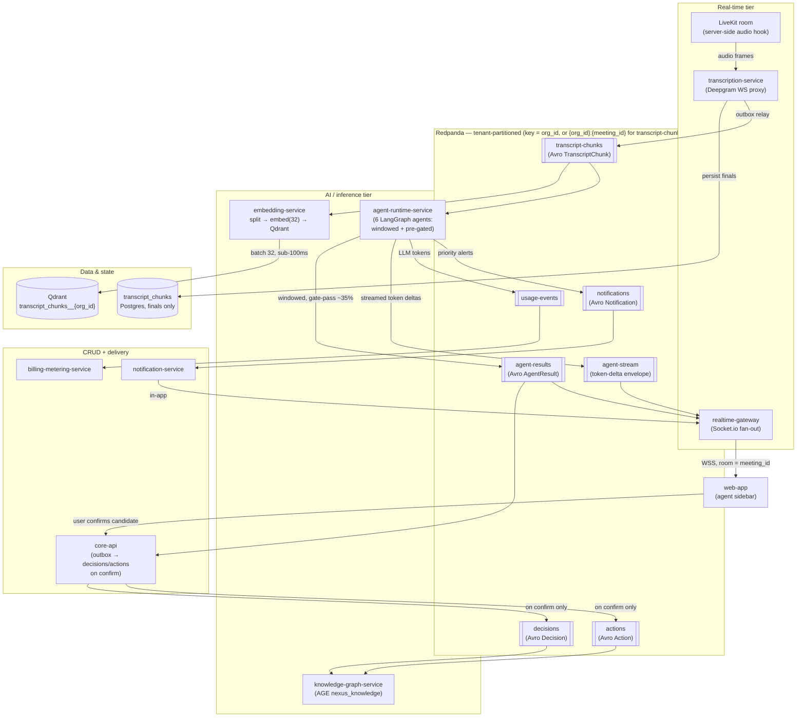
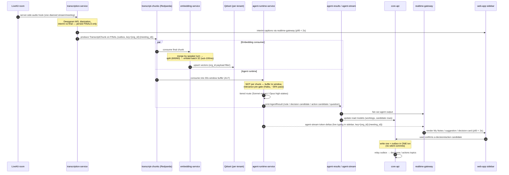
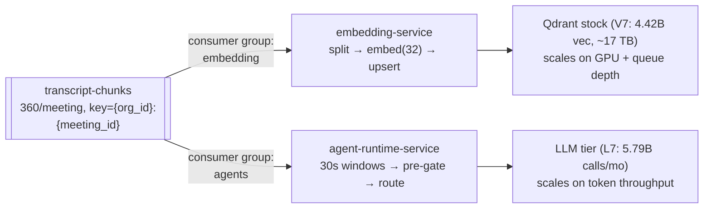

# Event Flow: transcript to agent outputs

The single hot-path trace of how a spoken utterance becomes a transcript chunk, fans out to embedding and the agent runtime, and surfaces as agent output in the meeting-room sidebar — with every hop named in canon and every event topic, partition key, and latency budget made explicit.

## Related documents

- [Event-Driven Architecture](../07-event-architecture.md) — topic catalog, Avro envelope, outbox/inbox, DLQs, the system-level flow this diagram zooms into.
- [AI Agent Architecture](../08-ai-agent-architecture.md) — the six agents, BaseAgent lifecycle, the cost-controlled pipeline, no-silent-commits.
- [Real-time & Transcription](../10-realtime-and-transcription.md) — LiveKit transport, Deepgram WS proxy, `realtime-gateway`, the latency budget.
- [RAG & Inference Serving](../09-rag-and-inference-serving.md) — the dedicated embedding/reranker inference tier.
- [Data Architecture](../05-data-architecture.md) — `transcript_chunks` storage, Qdrant collections, AGE `nexus_knowledge`.
- [Service Catalog](../04-service-catalog.md) — the canonical service names used here.
- [Multi-Tenancy & Isolation](../06-multi-tenancy.md) — tenant-keyed partitions, `org_id` injection.
- [Capacity & Scaling Math](../_canon/05-capacity-math.md) — every number cited here (chunks/meeting, windows, gate-pass, SLOs).

---

## 1. Scope

This document traces exactly one path end to end: **meeting audio → `transcription-service` → `transcript-chunks` → (embedding consumer + `agent-runtime-service`) → `agent-results` / `decisions` / `actions` → `realtime-gateway` → UI.** It is a companion to the system-level flow in [§5 of the Event Architecture](../07-event-architecture.md); that doc draws the whole bus, this one walks the single hottest path step by step with the partition keys, the windowing collapse, and the confirmation gate spelled out.

Two facts govern the entire trace and are frozen elsewhere; everything below is consistent with them:

1. **Agents consume `transcript-chunks` but never run per chunk.** `agent-runtime-service` applies **30 s windowed batching** ([Capacity A17](../_canon/05-capacity-math.md)) and **relevance pre-gating** before any LLM call — the fix for the R4 cost bomb. The bus delivers **360 chunks/meeting** (Capacity T2); the pipeline collapses that to **~90 windows** with a **~35% gate-pass** (Capacity §8.2).
2. **`decisions` and `actions` are produced by `core-api` on user confirmation — not by the agent.** The agent surfaces a *candidate* on `agent-results`; only after the user confirms in the sidebar does `core-api` write the row and the outbox record in one transaction, which relays to the `decisions` / `actions` topics. This is the structural enforcement of the PDF "no silent commits" rule.

---

## 2. The end-to-end flow (primary diagram)

This is the full hot path as a single flow. Audio enters server-side from the LiveKit room hook; finals leave as `transcript-chunks`; the chunk fans out to two independent consumers (embedding + agents); agent output returns to the user through `realtime-gateway`.

> [SaaS-scale adjustment] Every topic above is **tenant-partitioned**: `transcript-chunks` and `agent-stream` use the composite key `{org_id}:{meeting_id}` ([ADR-0017](../adr/0017-transcript-chunks-composite-partition-key.md)); every other topic on this path (`agent-results`, `decisions`, `actions`, `notifications`, `usage-events`) uses `org_id` alone (see [Multi-Tenancy](../06-multi-tenancy.md)). The Qdrant target is the per-tenant collection `transcript_chunks__{org_id}` rather than the PDF's single shared collection. The PDF carried no tenant key on events or vectors.

---

## 3. The same path as an ordered sequence

The flowchart shows topology; the sequence below shows ordering and the two key collapses (windowing and the confirmation gate). Times annotate the live-intelligence budget ([Capacity §11.1](../_canon/05-capacity-math.md): agent end-to-end **p50 < 2 s, p95 < 4 s**; live captions **p95 < 2 s**).

---

## 4. Stage-by-stage contract

Each row names the producing/consuming service from the [Service Catalog](../04-service-catalog.md), the canonical topic, and the volume per meeting from [Capacity §4–§8](../_canon/05-capacity-math.md).

| # | Stage | Service (owner) | Input | Output topic / store | Per-meeting volume |
|---|---|---|---|---|---|
| 1 | Audio capture | `meeting-service` (LiveKit adapter) → server-side hook | LiveKit room audio | Internal WS to `transcription-service` | 1 diarized stream/meeting |
| 2 | Transcribe | `transcription-service` (Deepgram WS proxy) | audio frames | `transcript_chunks` (finals only) + `transcript-chunks` topic | **360 finals** (T2) |
| 3a | Embed | `embedding-service` | `transcript-chunks` | Qdrant `transcript_chunks__{org_id}` | **~62.5 vectors** (V2) |
| 3b | Reason | `agent-runtime-service` (6 agents) | `transcript-chunks` → 30 s windows | `agent-results`, `agent-stream`, `usage-events`, `notifications` | **~90 windows**, ~35% gate-pass → **756 agent-results** (E3); **~1,260 stream deltas** (E8) |
| 4 | Deliver | `realtime-gateway` | `agent-results`, `agent-stream`, `notifications` | Socket.io / WSS to `web-app`, room = `meeting_id` | per gate-passing window |
| 5 | Confirm | `core-api` (outbox) | user confirmation from sidebar | `decisions`, `actions` topics | **3 decisions, 5 actions** (E4, E5) |
| 6 | Graph | `knowledge-graph-service` | `decisions`, `actions` (on confirm) | AGE `nexus_knowledge` edges | `PRODUCED`, `ASSIGNED_TO` edges |

> [SaaS-scale adjustment] The fan-out at stage 2 is the architectural fix for PDF risks **R4** (LLM cost spiral) and **R5** (tight latency budget): the embedding consumer and `agent-runtime-service` are **separate consumer groups on `transcript-chunks`, on the independently autoscaled AI/inference tier**, off the CRUD API tier. The PDF ran BGE embeddings via ONNX on the same FastAPI service that served requests and processed every chunk per participant. Here embedding scales on queue depth + GPU, agents scale on token throughput, and neither is throttled by API req/s.

---

## 5. Why the fan-out splits at `transcript-chunks`

The same `transcript-chunks` topic feeds two consumer groups with opposite scaling profiles and opposite cost drivers. The split is deliberate.

- **Independent offsets.** A slow embedding upsert never delays an agent response and vice versa; each group commits its own offset and has its own per-topic DLQ.
- **Independent autoscalers.** Embedding is a KEDA signal on queue depth + GPU utilization; agents on token throughput + chunk backlog ([Service Catalog §4](../04-service-catalog.md)).
- **Different math.** Embedding produces a bounded *stock* (V7 = 4.42B vectors); agents produce a *flow* of LLM calls (L7 = 5.79B/month). They are sized and billed separately.

---

## 6. Legend

| Symbol / convention | Meaning |
|---|---|
| `[[ name ]]` (subroutine shape) | A **Redpanda topic** (canonical name). All are tenant-partitioned, Avro-serialized, `{topic}-value` subject, BACKWARD compatible. |
| `[( name )]` (cylinder) | A **durable store**: Postgres table, Qdrant collection, or AGE graph. |
| Plain box | A **microservice** (canonical name from the [Service Catalog](../04-service-catalog.md)). |
| `par … and …` (sequence) | Concurrent fan-out — embedding and agent consumer groups run in parallel off the same chunk. |
| Solid arrow | Asynchronous event over the bus, or a synchronous internal call where labeled. |
| Dashed arrow (`-->>`) | Streamed deltas (`agent-stream` token-by-token to the UI). |
| `key = org_id` | The tenant partition key on `agent-results`, `decisions`, `actions`, `notifications`, `usage-events`. |
| `key = {org_id}:{meeting_id}` | The composite partition key on `transcript-chunks` and `agent-stream` only ([ADR-0017](../adr/0017-transcript-chunks-composite-partition-key.md)). |
| `__{org_id}` suffix | The per-tenant physical Qdrant collection resolved from the logical name. |

---

## 7. Key flow notes

- **Captions and agent output are two different SLOs on two different planes.** Interim/final captions ride `transcription-service` → `realtime-gateway` and target **p95 < 2 s** ([Capacity §11.1](../_canon/05-capacity-math.md)); agent sidebar output rides the longer chunk → window → gate → LLM → `agent-results` path and targets **p50 < 2 s, p95 < 4 s**. Streaming `agent-stream` deltas hide the LLM latency by rendering tokens as they arrive.
- **The 360 → 90 collapse is the whole cost story.** The bus delivers 360 `transcript-chunks` per meeting, but `agent-runtime-service` buffers them into ~90 thirty-second windows ([A17](../_canon/05-capacity-math.md)) and a Haiku relevance pre-gate drops ~65% before any extraction model runs — an 86% reduction (L10) versus the naive per-chunk-per-participant path. Agents never run per raw chunk.
- **`decisions` and `actions` are produced by `core-api`, never by the agent.** The agent emits a *candidate* on `agent-results`; the sidebar renders a confirm/edit/dismiss card; only on user confirmation does `core-api` write the row and an outbox record in one transaction and relay to the `decisions` / `actions` topics. This is the "no silent commits" rule made structural — and the anchor of the duplicate-decision fix in [Event Architecture §9](../07-event-architecture.md).
- **AGE edges are written on confirmation only.** `knowledge-graph-service` consumes the confirmed `decisions` / `actions` topics and creates `PRODUCED` (Decision/Action → Meeting) and `ASSIGNED_TO` (Action → Person) edges in `nexus_knowledge`. No speculative graph writes from agent candidates.
- **At-least-once everywhere, deduped on `idempotency_key`.** Every arrow into a consumer is at-least-once; consumers dedupe via an inbox table + the `nexus:{org_id}:dedupe:{topic}:{idempotency_key}` Redis cache, and poison messages land in a per-topic DLQ ([Event Architecture §6–§7](../07-event-architecture.md)).
- **Metering is a byproduct of the same path.** `agent-runtime-service` emits `usage-events` (LLM tokens) alongside `agent-results`; `billing-metering-service` aggregates them into per-tenant token budgets and hard quotas, so the cost of this exact flow is metered as it happens.

> [SaaS-scale adjustment] `usage-events`, the per-tenant Qdrant collection, and the tenant partition key on every topic (`org_id` alone, or the composite `{org_id}:{meeting_id}` on `transcript-chunks`/`agent-stream`, [ADR-0017](../adr/0017-transcript-chunks-composite-partition-key.md)) are SaaS-scale additions absent from the PDF, which had neither tenant isolation nor usage metering on the transcript→agent path.
