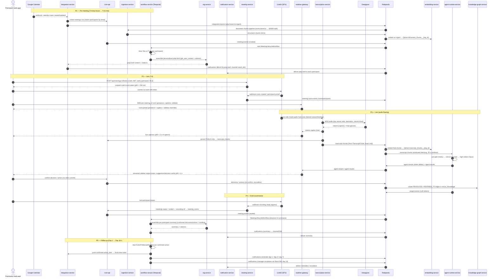
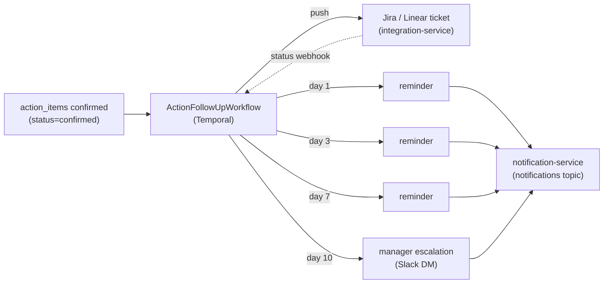

# Meeting Lifecycle Sequence

The single end-to-end sequence view of one NEXUS meeting — from a Google Calendar event and personalized prep brief, through LiveKit join, live Deepgram transcription and agent sidebar intelligence, to the post-meeting summary and the Temporal-driven follow-up — naming every service, topic, and entity exactly as the canon freezes them.

## Related documents

- [Service Catalog](../04-service-catalog.md) — the canonical service names and ownership used in every lane below.
- [Real-time & Transcription](../10-realtime-and-transcription.md) — the live path (token mint, Deepgram proxy, captions, fan-out) this diagram sequences.
- [AI Agent Architecture](../08-ai-agent-architecture.md) — the seven LangGraph agents, windowed batching, confidence thresholds.
- [RAG & Inference Serving](../09-rag-and-inference-serving.md) — the `RAGService` pipeline reused for prep briefs and summaries.
- [Integration Architecture](../21-integration-architecture.md) — Calendar auto-create, Slack prep brief / summary, Jira/Linear action sync, `ActionFollowUpWorkflow`.
- [Event-Driven Architecture](../07-event-architecture.md) — Avro schemas, outbox/inbox, idempotency, DLQs for every arrow here.
- [Data Architecture](../05-data-architecture.md) — store selection, partitioning, and retention for the entities written along the way.
- [Service Catalog (canon)](../_canon/01-service-catalog.md) · [Data Model (canon)](../_canon/02-data-model.md) · [Capacity Math (canon)](../_canon/05-capacity-math.md) · [Tech Decisions (canon)](../_canon/06-tech-decisions.md) — frozen names and numbers.

---

## 1. Purpose and scope

This document is a **sequence reference**: it does not introduce new services, topics, or entities, and it does not re-derive load or re-define schemas. It stitches the pieces other documents own into one chronological narrative for a single meeting, so an engineer can trace any signal — a caption, a detected decision, a follow-up reminder — back to the service that produced it and the topic it rode.

The lifecycle has **five phases**:

| Phase | Window | Trigger | Owning services |
| --- | --- | --- | --- |
| **P1 Pre-meeting** | T-minus hours → T-15 min | Google Calendar event sync | `integration-service`, `core-api`, `ingestion-service`, `workflow-service` |
| **P2 Join** | T-0 | Participant opens meeting room | `meeting-service`, `realtime-gateway`, LiveKit |
| **P3 Live** | T-0 → meeting end | Audio flowing | `transcription-service`, `agent-runtime-service`, `realtime-gateway`, `embedding-service` |
| **P4 End & summarize** | Meeting end | LiveKit `recording.ready` / last participant leaves | `meeting-service`, `core-api`, `rag-service`, `knowledge-graph-service`, `notification-service` |
| **P5 Follow-up** | Day 1 → Day 10+ | Confirmed `action_items` | `workflow-service` (`ActionFollowUpWorkflow`), `integration-service`, `notification-service` |

Two invariants from the canon bind every arrow:

1. **At-least-once with idempotency.** Every topic message is produced through a transactional outbox and consumed through an inbox/dedupe cache keyed by idempotency key, with a per-topic DLQ. See [Event-Driven Architecture](../07-event-architecture.md).
2. **No silent commits.** Agents *surface* decisions and actions; the `Decision`/`Action` rows reach `confirmed` status — and therefore the `nexus_knowledge` graph — only on explicit user confirmation. Confidence thresholds gate surfacing: **`>0.7` surface · `0.4–0.7` silent log · `<0.4` drop**.

---

## 2. The full lifecycle sequence

The diagram below is the canonical end-to-end flow. Participants are the canonical services; LiveKit and Deepgram are external subprocessors; Redpanda is the event bus all the tenant-partitioned topics ride.

> [SaaS-scale adjustment] Several lanes in this sequence are wholly SaaS-scale, not in the PDF: the `integration-events` attachment-to-ingest hop, `embed-on-ingest` to **per-tenant** Qdrant collections (`document_chunks__{org_id}` / `transcript_chunks__{org_id}`), the `meeting-events` / `meeting-room-events` lifecycle topics that drive `MeetingLifecycleWorkflow`, the `usage-events` token-metering arm feeding `billing-metering-service`, and the deduped LiveKit-webhook inbox. The PDF created meetings in-process, embedded into one shared store, and emitted Slack messages directly from the integration feature. See [Service Catalog §5](../04-service-catalog.md) and [Event-Driven Architecture](../07-event-architecture.md).

---

## 3. Phase detail

### 3.1 P1 — Pre-meeting: event → meeting → prep brief

A Google Calendar event becomes a NEXUS `meetings` row: `integration-service` matches participants by email to `users`, and routes any event attachment through `ingestion-service` (unstructured.io → typed elements → LangChain `RecursiveCharacterTextSplitter` 600/60 → `document-chunks`) so it is **searchable before the meeting starts**. `core-api` emits `meeting-events (created)`, which starts the Temporal `MeetingLifecycleWorkflow`.

> [SaaS-scale adjustment] The prep brief is built **per participant** by the `RAGService` pipeline (`get_user_context` + hybrid retrieve over the now-embedded attachments), then handed to `notification-service` for delivery — `integration-service` *constructs* the Block Kit blocks but `notification-service` is the sole component authorized to fan `notifications` to external channels. A Temporal child timer fires at **T-minus-15 minutes** per matched participant. The PDF emitted Slack messages directly from the integration feature with no delivery-fabric split. See [Integration Architecture §4.2](../21-integration-architecture.md).

### 3.2 P2 — Join: participant verification and token mint

`meeting-service` owns `POST /api/meetings/:id/token`: it verifies the caller is a `meeting_participants` row for that meeting under RLS, then mints a scoped LiveKit room token. This is a single RLS DB read plus a mint, budgeted at **p95 < 250 ms** ([Capacity §11.1](../_canon/05-capacity-math.md)). The client connects to LiveKit; `room.created` / `participant.joined` webhooks land on `meeting-service`, which emits `meeting-room-events`. In parallel the client opens a WSS connection to `realtime-gateway` joining the Socket.io room keyed by `meeting_id` for presence, captions, and sidebar output.

### 3.3 P3 — Live: transcription, captions, and the agent sidebar

LiveKit delivers **mixed room audio** to `transcription-service` over a server-side hook — **one diarized Deepgram stream per meeting**, the locked 6× cost lever (not one stream per participant). Two carried-over rules govern durability:

- **Interim vs final are separated.** Interims drive live captions (mutable, low-latency, **never persisted**, never on the bus). Captions reach the UI at **p95 < 2 s** of speech via `realtime-gateway`.
- **Persist finals only.** Each `is_final` utterance is merged by speaker turn, written as one `transcript_chunks` row (indexed `(meeting_id, start_ms)`), and emitted to the `transcript-chunks` topic as Avro `TranscriptChunk`. Diarized `speaker_id` is mapped to `user_id` via `meeting_speakers` downstream — reliable manual assignment plus a confidence-scored suggestion (PDF R7), never guessed at write time.

The `transcript-chunks` topic fans to two consumers: `embedding-service` (embed-on-ingest to the per-tenant Qdrant `transcript_chunks__{org_id}` collection) and `agent-runtime-service`.

> [SaaS-scale adjustment] `agent-runtime-service` does **not** run an agent per raw chunk (the PDF R4 cost bomb). It runs the locked cost-controlled pipeline: **30 s windowed batching → relevance pre-gating (Haiku) → tiered extraction (Sonnet) → high-stakes reasoning (Opus) → prompt caching → per-tenant token budgets**. This is an **86% LLM-call reduction** vs naive per-chunk ([Capacity §8](../_canon/05-capacity-math.md)). Streamed output rides `agent-stream` (token deltas) to `realtime-gateway`; durable agent output rides `agent-results`. End-to-end speech → first sidebar token is budgeted **p50 < 2 s, p95 < 4 s** (PDF R5).

The seven agents act here: **PersonalListenerAgent** writes per-user `worklogs`; **DecisionAgent** / **ActionAgent** surface decisions/actions as confirm/edit/dismiss cards; **QuestionAgent** emits `agent_suggestions` (priority 1–3); **ContextGapAgent** fills cross-meeting context over `agent-requests`/`agent-responses`; **ProactiveAgent** raises conflict/workload/stakeholder alerts; **MeetingAgent** (one per meeting, only with an agenda) updates agenda item statuses for everyone and nudges the host ([ADR-0038](../adr/0038-agent-personas-profiles-agendas-and-meeting-agent.md)). On user **confirmation**, `core-api` emits `decisions`/`actions` through its outbox, and `knowledge-graph-service` creates the `PRODUCED` (Decision/Action→Meeting) and `ASSIGNED_TO` (Action→Person) edges in `nexus_knowledge`. Every LLM call emits `usage-events` for metering.

### 3.4 P4 — End & summarize

When the last participant leaves, LiveKit fires `recording.ready` (egress); `meeting-service` records the egress reference into `meeting_rooms` (recording object lands in `mytheus-recordings` at `{org_id}/{meeting_id}/`) and `core-api` sets `meetings.status = ended`, emitting `meeting-events (ended)`. The `MeetingLifecycleWorkflow` advances to its summarize step: `rag-service` assembles a **per-participant** summary from confirmed `decisions`/`action_items` and the user's `worklogs`, with citations; `notification-service` delivers it to channel/DM.

### 3.5 P5 — Follow-up: ActionFollowUpWorkflow and ticket sync

For each confirmed `action_item`, `workflow-service` starts the Temporal `ActionFollowUpWorkflow`. `integration-service` pushes the action to an external ticket (Jira default / Linear alt) and keeps it bidirectionally synced (external status → `actions` update via webhook). The workflow sends **reminders at day 1, day 3, day 7**, and **escalates to the assignee's manager via Slack DM at day 10** — all through `notification-service` on the `notifications` topic. Manager lookup traverses the `departments` org hierarchy.

---

## 4. Legend

| Symbol / lane | Meaning |
| --- | --- |
| **Solid arrow `->>`** | Synchronous call (HTTP/WSS) or in-process produce-to-outbox; caller awaits. |
| **Dashed arrow `-->>`** | Asynchronous return, webhook callback, or streamed delivery. |
| **`RP` (Redpanda)** | The tenant-partitioned event bus; every hop through it is at-least-once with an idempotency key and a per-topic DLQ. |
| **External participants** | `GCAL` (Google Calendar), `LK` (LiveKit SFU), `DG` (Deepgram) are subprocessors, always behind an adapter. |
| **Topic names** | `transcript-chunks`, `document-chunks`, `agent-results`, `agent-stream`, `decisions`, `actions`, `notifications`, `meeting-events`, `meeting-room-events`, `integration-events`, `usage-events` — verbatim from canon. |
| **`__{org_id}` suffix** | Physical per-tenant Qdrant collection; logical names are `transcript_chunks` / `document_chunks`. |
| **Latency annotations** | SLOs imported from [Capacity §11](../_canon/05-capacity-math.md); not re-derived here. |

---

## 5. Key flow notes

- **Two anchors, two real-time lanes.** `transcription-service` scales on **A5 = 20,000 peak concurrent meetings** (one diarized stream each); `realtime-gateway` scales on **A6 = 100,000 peak concurrent participant connections**. They are the same scaling family but opposite autoscaler signals — never size one off the other.
- **Finals are the system of record.** Interims are throwaway captions; only `is_final` utterances reach `transcript_chunks` and the `transcript-chunks` topic. A dropped socket re-mints its LiveKit token, re-joins the `meeting_id` room, and re-hydrates captions and confirmed agent output from `core-api` — durable finals mean no transcript is ever lost on reconnect.
- **The graph mirrors confirmed truth only.** `nexus_knowledge` edges (`PRODUCED`, `ASSIGNED_TO`, plus `ATTENDED` on join, `RELATES_TO` on topic extraction, `FOLLOWS_FROM` on lineage) are written by `knowledge-graph-service` only after a user confirms the `decisions`/`actions` row — there is no speculative graph write, matching the PDF confirmation rule and `>0.7`/`0.4–0.7`/`<0.4` thresholds.
- **One workflow spans the meeting; a child workflow spans each action.** `MeetingLifecycleWorkflow` owns the durable timeline (prep-brief timer at T-15 → live → summarize); each confirmed action spawns its own `ActionFollowUpWorkflow` for the day 1/3/7 reminder cadence and day-10 manager escalation, so a long-overdue action never blocks the parent meeting's completion.
- **Cost and metering are inline, not bolted on.** Every agent LLM call emits a `usage-events` message consumed by `billing-metering-service` for aggregation → per-tenant token budgets and hard quotas; the windowed-batching + tiered-routing pipeline is what keeps this lane affordable (the **86%** call-volume reduction, [Capacity §8](../_canon/05-capacity-math.md)).
- **Idempotency makes redelivery safe at every hop.** A redelivered LiveKit `recording.ready` cannot double-write `meeting_rooms`, a redelivered `transcript-chunks` message cannot double-embed, and a redelivered `actions` message cannot create a duplicate `ASSIGNED_TO` edge — each consumer dedupes on its idempotency key via the `nexus:{org_id}:dedupe:*` inbox cache. See [Event-Driven Architecture §6](../07-event-architecture.md).
