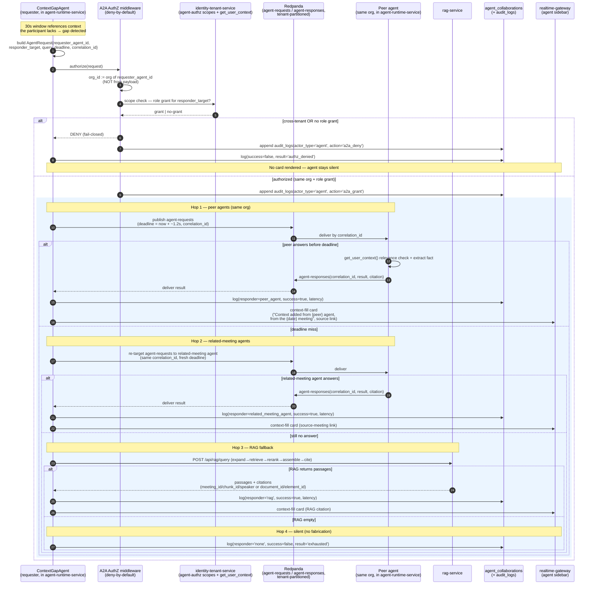
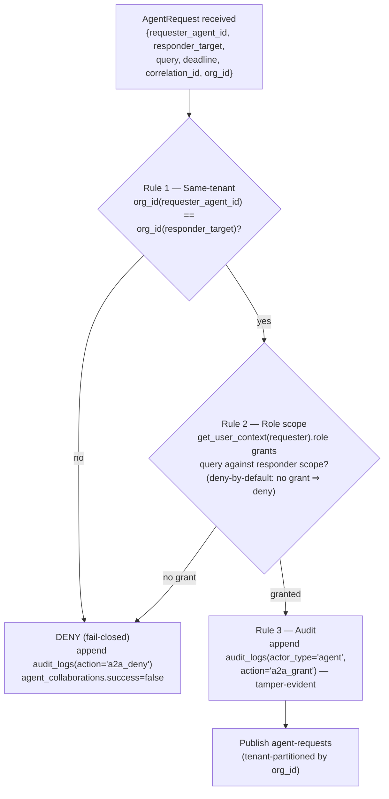

# Multi-Agent Collaboration Sequence

The end-to-end sequence by which a participant's `ContextGapAgent` detects a context gap, passes a deny-by-default authorization check, asks a peer agent over Redpanda, falls through the canonical chain to RAG when peers miss, and renders a source-attributed context-fill card — or stays silent.

## Related documents

- [AI Agent Architecture](../08-ai-agent-architecture.md) — the six agents, the `BaseAgent`/`AgentState` contract, the collaboration protocol prose this diagram realizes.
- [Event Architecture](../07-event-architecture.md) — `agent-requests` / `agent-responses` Avro envelopes, tenant partitioning, outbox/inbox/DLQ delivery.
- [Security Architecture](../11-security-architecture.md) — agent-to-agent authorization, RBAC grants, `audit_logs`.
- [RAG Pipeline & Inference Serving](../09-rag-and-inference-serving.md) — the `rag-service` pipeline the fallback chain terminates in.
- [Data Architecture](../05-data-architecture.md) — the `agent_collaborations`, `worklogs`, `decisions`, `action_items` tables and retention.
- [Service Catalog](../_canon/01-service-catalog.md) — canonical service names (`agent-runtime-service`, `rag-service`, `identity-tenant-service`, `realtime-gateway`).
- [Capacity & Scaling Math](../_canon/05-capacity-math.md) — the `< 1.5s` A2A round-trip p95 budget and `E7` collaboration round-trip volume.
- [Tech Decisions](../_canon/06-tech-decisions.md) — locked agent roster, fallback chain, deny-by-default A2A authz.

---

## 1. What this diagram covers

`ContextGapAgent` is the novel, least-proven piece of NEXUS (PDF risk **R6**): a participant's personal agent can ask **other users' agents** for context the participant lacks, across meeting boundaries, over the `agent-requests` / `agent-responses` topics. This document is the canonical sequence for that flow. It shows, in order:

1. **Gap detection** inside the `agent-runtime-service` from a 30-second window of speaker-merged utterances.
2. The **deny-by-default authorization check** that scopes every request to the requester's own tenant and role.
3. The **authorized `agent-requests`** publish over tenant-partitioned Redpanda, with a per-hop deadline and `correlation_id`.
4. The **peer agent response** (or a deadline miss).
5. The canonical **fallback chain** `peer-agents → related-meeting agents → RAG → silent`.
6. The **context-fill card** with source attribution rendered to the participant via `realtime-gateway`.
7. The **`agent_collaborations`** audit write that closes every round-trip — success, fall-through, or denial.

> [SaaS-scale adjustment] In the PDF, agents requested context freely inside a single-tenant FastAPI process — there was no tenant boundary, so a request could in principle reach any agent. At SaaS scale that is a cross-tenant data leak. Every step below adds tenant isolation: a deny-by-default A2A authorization gate, `org_id` derived from the bound `requester_agent_id` (never from the payload), tenant-partitioned topics, and an append-only audit trail. The six agent names, the fallback chain, `get_user_context`, and the topic names are carried over verbatim from the PDF.

---

## 2. The collaboration sequence (canonical)

This is the full sequence: gap → authorize → peer request → response-or-miss → fall-through to RAG → silent → context-fill card. Lifelines use canonical service and table names.

> [SaaS-scale adjustment] The `now + ~1.2s` per-hop deadline is **illustrative, not frozen canon**. The frozen number is the **A2A round-trip p95 `< 1.5s`** budget (Capacity §11.1), which must hold end-to-end across all hops so a fill lands inside the live conversation. Per-hop deadlines are tuned operationally against that p95 envelope; they leave headroom for fall-through to the next hop.

---

## 3. The authorization check, expanded

The authorization gate runs **before** any `agent-requests` message is published. It is fail-closed: any check that does not affirmatively pass results in `DENY`.

Three rules, all enforced in the `agent-runtime-service` authz middleware against grants owned by `identity-tenant-service`:

1. **Same-tenant only.** `org_id` is derived from the **bound `requester_agent_id`**, never trusted from the payload. If `responder_target` resolves to a different tenant, the request is denied. Agents can **never** cross org boundaries.
2. **Role scope.** The requester's role — from `get_user_context(user_id)` — must hold an authorization grant for the target's scope. Grants are stored as agent-authz scopes in `identity-tenant-service` and are **deny-by-default**: no grant means deny.
3. **Audit.** Every grant and every denial is appended to `audit_logs` (`actor_type = 'agent'`, append-only, tamper-evident) and reflected in `agent_collaborations.success`.

Because every topic is tenant-partitioned - `agent-requests`/`agent-responses` by `org_id` alone, like 19 of the 21 topics ([Event Architecture](../07-event-architecture.md)) - a request is physically constrained to its own tenant's partitions; the authz check is defense-in-depth on top of that partitioning.

---

## 4. The `AgentRequest` / `AgentResponse` envelope

The collaboration topics carry the PDF-original fields (names verbatim) plus the SaaS-scale tenant key. Full Avro schemas live in [Event Architecture](../07-event-architecture.md); the fields that drive the sequence above:

| Field | Carried in | Meaning |
|---|---|---|
| `requester_agent_id` | `AgentRequest` | Stable agent identity; binds `org_id` + role scope. AuthZ derives tenant from this, not the payload. |
| `responder_target` | `AgentRequest` | Peer agent, related-meeting agent, or `"rag"`. Resolved per fallback hop. |
| `query` | `AgentRequest` | The context question the participant lacks an answer to. |
| `deadline` | `AgentRequest` | Epoch ms; per-hop budget under the `< 1.5s` round-trip p95. On miss → fall through. |
| `correlation_id` | both | Matches request to response; also keys the `agent_collaborations` row. |
| `org_id` | both (envelope header) | Tenant key and Redpanda partition key; validated by Rule 1. |
| `result` | `AgentResponse` | The extracted fact + citation, or empty on no-answer. |

> [SaaS-scale adjustment] `org_id` on the envelope is the SaaS-scale addition; the PDF `AgentRequest`/`AgentResponse` had no tenant key because the PDF had no tenants. `requester_agent_id`, `responder_target`, `query`, `deadline`, and `correlation_id` are PDF-original, carried verbatim.

---

## 5. Legend

| Symbol / lifeline | Meaning |
|---|---|
| `ContextGapAgent` | The requesting agent: detects the gap, drives the fallback chain, renders the card. Hosted in `agent-runtime-service`. |
| `A2A AuthZ middleware` | The deny-by-default authorization gate in `agent-runtime-service` that every `agent-requests` message passes through before publish. |
| `identity-tenant-service` | Source of agent-authz role grants and `get_user_context(user_id)`. |
| `Redpanda` | The `agent-requests` / `agent-responses` topics, **tenant-partitioned** by `org_id`, at-least-once with idempotency on `correlation_id`. |
| `Peer agent` | Another participant's agent in the **same org**; answers from its own worklog/context or declines. |
| `rag-service` | Terminal fallback: the `expand → retrieve → rerank → assemble → cite` pipeline. |
| `agent_collaborations` | The table logging `requester`, `responder`, `query`, `result`, `success`, `latency` for every round-trip; feeds R5/R6 dashboards. |
| `realtime-gateway` | Socket.io fan-out that delivers the context-fill card into the agent sidebar. |
| `rect` shaded block | The authorized happy path and its nested fall-through hops. |
| `alt` / `else` | A decision branch (authorized vs denied; answered-before-deadline vs miss). |

---

## 6. Key flow notes

- **Gap → window, not chunk.** `ContextGapAgent` detects a gap from a **30-second window** of speaker-merged utterances (the `A17` windowed-batching unit that defeats the R4 cost bomb), not from a single `transcript_chunks` row. The window is the `chunk` field on the shared `AgentState`. See [AI Agent Architecture](../08-ai-agent-architecture.md).

- **Authorize before publish, fail-closed.** No `agent-requests` message is published until the three-rule check passes. The tenant key is derived from the bound `requester_agent_id`, so a forged `org_id` in a payload cannot widen scope. This is the central security fix for the collaboration protocol ([Tech Decisions §2.6](../_canon/06-tech-decisions.md), [Security Architecture](../11-security-architecture.md)).

- **The fallback chain is PDF-verbatim:** `peer-agents → related-meeting agents → RAG → silent`. Each hop carries a deadline; on miss the agent falls through to the next hop reusing the same `correlation_id`. If every hop misses, the agent stays **silent** — it never fabricates a fill. The `< 1.5s` round-trip p95 (Capacity §11.1) bounds the whole chain so a fill lands inside the live conversation.

- **Citations are mandatory and source-attributed.** Every context-fill card carries provenance: a peer/related-meeting answer links to the **source meeting** ("Context added from {X} agent, from the {date} meeting"), and a RAG answer carries the citation contract `meeting_id` + `chunk_id` + `speaker` (transcripts) or `document_id` + `element_id` (documents). The card is calm, not flashy, per the sidebar animation discipline.

- **Every round-trip is logged.** Success, fall-through, and denial all write an `agent_collaborations` row (`requester`, `responder`, `query`, `result`, `success`, `latency`). Denials additionally append to `audit_logs` (`actor_type = 'agent'`). Latency feeds the R5 (agent latency) and R6 (collaboration reliability) dashboards in [Data Architecture](../05-data-architecture.md).

- **R6 descope is pre-authorized.** If peer collaboration proves unreliable in production, the chain collapses to **RAG-only** context fill and peer-agent collaboration ships as v2 — the diagram degrades cleanly to its Hop 3 path. The fallback chain itself is PDF-original; only the descope authorization is a planning decision ([Tech Decisions §2.6](../_canon/06-tech-decisions.md)).

> [SaaS-scale adjustment] The `agent_collaborations` audit write, the `audit_logs` grant/deny records, and the per-tenant partitioning of `agent-requests` / `agent-responses` are all SaaS-scale additions. The PDF logged collaboration latency for the R5/R6 dashboards but had no tenant-scoped audit trail because it had no tenants.
