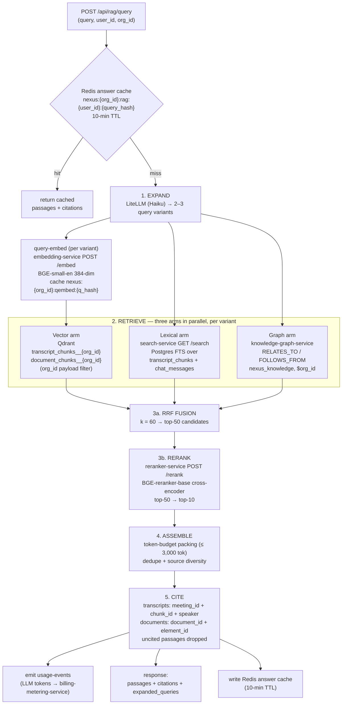
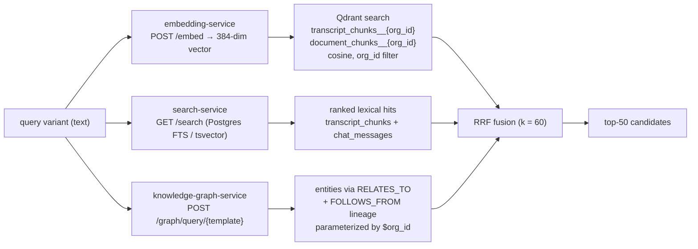

# RAG Pipeline Flow

A focused, diagram-first walkthrough of the NEXUS `RAGService` request path — query expansion → hybrid retrieval (Qdrant + Postgres FTS + AGE) → RRF fusion → `reranker-service` → context assembly → citations — using only canonical service, store, and topic names.

## Related documents

- [RAG & Inference Serving](../09-rag-and-inference-serving.md) — the full prose specification this diagram set illustrates (stage code, latency table, `embedding-service` / `reranker-service` internals).
- [Service Catalog](../_canon/01-service-catalog.md) — canonical ownership of `rag-service`, `embedding-service`, `reranker-service`, `search-service`, `knowledge-graph-service`.
- [Data Model](../_canon/02-data-model.md) — Qdrant collections, citation payload contract, `nexus_knowledge` labels, Redis key namespaces.
- [Capacity & Scaling Math](../_canon/05-capacity-math.md) — RAG latency SLOs and query-embed throughput.
- [Locked Tech & Architecture Decisions](../_canon/06-tech-decisions.md) — frozen RAG pipeline shape, BGE models, hybrid retrieval, citation rule.
- [AI / Agent Architecture](../08-ai-agent-architecture.md) — the agent LLM pipeline that consumes RAG context; query-expansion routing through LiteLLM.

---

## 1. Purpose and scope

This document is the **visual reference** for one thing: the synchronous read path behind `POST /api/rag/query`. It does not re-specify the inference services or the agent LLM pipeline — those live in [RAG & Inference Serving](../09-rag-and-inference-serving.md) and [AI / Agent Architecture](../08-ai-agent-architecture.md). Here the diagrams are authoritative; the prose is a legend.

The pipeline shape is frozen (`06-tech-decisions.md` §2.9): `expand -> retrieve -> rerank -> assemble -> cite`. Every retrieval flows through all five stages; there is no shortcut that skips citation tracking.

---

## 2. The end-to-end RAG pipeline

The five numbered stages map one-to-one onto the locked `expand -> retrieve -> rerank -> assemble -> cite` contract. The cache check and `usage-events` emission bracket the pipeline; they are not pipeline stages but are load-bearing for cost and SLO.

> [SaaS-scale adjustment] Three elements on this diagram are SaaS-scale additions, not in the PDF: the tenant-prefixed answer cache key `nexus:{org_id}:rag:{user_id}:{query_hash}` (PDF key was the unscoped `(user_id, query_hash)`), the mandatory `org_id` payload filter on the per-tenant Qdrant collections `transcript_chunks__{org_id}` / `document_chunks__{org_id}`, and the `usage-events` emission that meters assembled-context LLM tokens to `billing-metering-service`. The five-stage pipeline shape, RRF, the BGE models, and the citation rule are all carried over verbatim.

---

## 3. Stage 2 detail — hybrid retrieval, three complementary signals

The three arms run **in parallel per variant**, so the retrieve stage is bounded by the slowest arm, not the sum of the three. Each arm carries the frozen citation payload through unbroken: the vector arm returns `meeting_id` / `chunk_id` / `speaker` (transcripts) or `document_id` / `element_id` (documents); the lexical and graph arms resolve to the same row identities. Tenant isolation is enforced on every arm — per-tenant Qdrant collection plus `org_id` payload filter, RLS on the FTS tables, and `$org_id`-parameterized Cypher over the org-partitioned `nexus_knowledge` graph.

---

## 4. Legend

| Symbol / label | Meaning |
| --- | --- |
| **EXPAND / RETRIEVE / RERANK / ASSEMBLE / CITE** | The five frozen `RAGService` stages (`expand -> retrieve -> rerank -> assemble -> cite`). |
| `rag-service` | Request-time orchestrator behind `POST /api/rag/query`; owns no data except the Redis answer cache. |
| `embedding-service` | Dedicated GPU inference (BGE-small-en, 384-dim) on Ray Serve / vLLM, off the API tier. Query-embed only at read time. |
| `reranker-service` | Dedicated GPU inference (BGE-reranker-base cross-encoder) on Ray Serve / vLLM, off the API tier. Scores top-50 → top-10. |
| `search-service` | Owns Postgres FTS (`tsvector`) over `transcript_chunks` + `chat_messages`; the lexical arm. |
| `knowledge-graph-service` | Owns the Apache AGE graph `nexus_knowledge`; the topic-relations arm via `RELATES_TO` / `FOLLOWS_FROM`. |
| `transcript_chunks__{org_id}` / `document_chunks__{org_id}` | Physical per-tenant Qdrant collections (logical names `transcript_chunks` / `document_chunks`). |
| `k = 60` | Standard Reciprocal Rank Fusion constant used to merge the three arms' ranked lists. |
| `usage-events` | Topic carrying LLM-token metering to `billing-metering-service`. |
| Dashed-free solid arrows | Synchronous, in-band calls on the < 500 ms warm read budget. |

---

## 5. Key flow notes

- **Cache-first, then expand.** A query is hashed to `nexus:{org_id}:rag:{user_id}:{query_hash}`; a hit returns cached passages + citations for the cost of one Redis `GET`, skipping the entire expand→retrieve→rerank cycle (10-min TTL, per [Data Model](../_canon/02-data-model.md) §5). This is the first line of cost defense against hot repeat queries.
- **Expand widens recall before fusion.** Query expansion (a small LiteLLM/Haiku call) returns **2–3 variants**; each variant is embedded once by `embedding-service` (query-embed only — the heavy embed-on-ingest flow at `V6 = 340M vectors/month`, [Capacity §9](../_canon/05-capacity-math.md), never touches the read path) and fanned across the three retrieval arms.
- **Three arms, one fusion.** Qdrant vector + Postgres FTS + AGE topic relations are complementary — dense semantics, exact lexical terms, and graph lineage — merged by RRF with `k = 60` into **top-50** candidates without needing comparable scores across arms.
- **Recall is cheap, precision is expensive.** The funnel runs cheap recall (vector/FTS/graph → RRF) before the expensive `reranker-service` cross-encoder, which scores only the 50 fused `(query, passage)` pairs and returns the **top-10**. The cross-encoder is the dominant latency contributor and the reason for the `< 500 ms` warm / `< 1.5 s` cold split ([Capacity §11.1](../_canon/05-capacity-math.md)).
- **Assembly is a cost surface, not just a quality knob.** Top-10 passages are packed under a hard **≤ 3,000-token** budget with dedupe and source diversity; every assembled token is billed downstream via `usage-events`, and the cap tightens automatically as a tenant nears its `agent_budgets` hard quota.
- **No uncited text ever ships.** Every returned passage is bound to its provenance — `meeting_id` + `chunk_id` + `speaker` for transcripts, `document_id` + `element_id` for documents — and any passage that cannot be cited is dropped before the response, enforcing the PDF's traceable-provenance rule.
