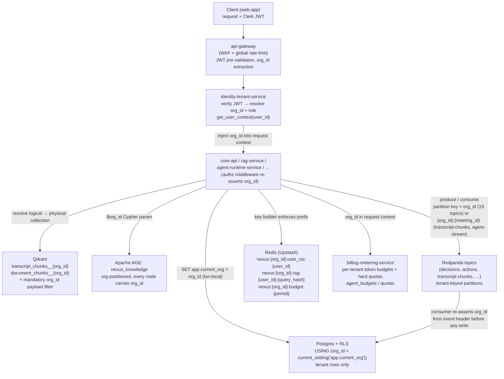
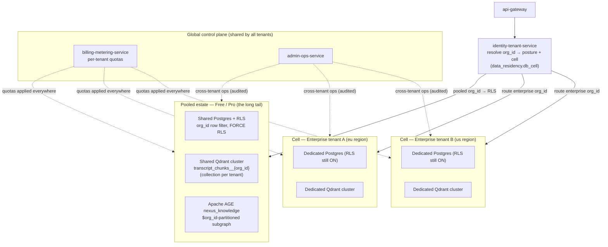

# Multi-Tenancy Isolation

A focused, diagram-first reference for how the tenant key `org_id` propagates from the edge through every NEXUS service into all six isolation backstops — Postgres RLS, per-tenant Qdrant collections, the org-partitioned `nexus_knowledge` graph, tenant-keyed Redpanda partitions, namespaced Redis, and tenant-scoped compute — and how the pooled long tail differs from cell-isolated enterprise tenants.

## Related documents

- [Multi-Tenancy & Tenant Isolation](../06-multi-tenancy.md) — the full prose specification this diagram set illustrates (RLS policy SQL, the `app.current_org` GUC rule, cell provisioning, agent-to-agent tenant binding). Here the diagrams are authoritative; the prose carries the detail.
- [Service Catalog](../_canon/01-service-catalog.md) — canonical service names (`api-gateway`, `identity-tenant-service`, `core-api`, `billing-metering-service`, `knowledge-graph-service`, …) and the `org_id`-injection chokepoint.
- [Data Model](../_canon/02-data-model.md) — the tenant key `org_id`, per-tenant Qdrant collection naming, the `nexus:{org_id}:…` Redis namespaces, and the RLS policy form.
- [Locked Tech & Architecture Decisions](../_canon/06-tech-decisions.md) — the locked tenancy model (pooled + RLS for the long tail, cells for enterprise) and the per-layer isolation rows.
- [Capacity & Scaling Math](../_canon/05-capacity-math.md) — the scale anchors this isolation must hold at (3,000 tenants, 5M users, 20k concurrent meetings).

---

## 1. Purpose and scope

This document is the **visual reference** for one thing: how a single request's `org_id` flows from the Clerk-verified JWT at the edge to a tenant-scoped result in each store, and how that same key shapes the pooled-vs-cell topology. It does not re-specify the RLS policy SQL, the connection-pool GUC hazard, or the right-to-be-forgotten purge — those live in [Multi-Tenancy & Tenant Isolation](../06-multi-tenancy.md). Here the diagrams are authoritative; the prose below is a legend.

The tenancy contract is frozen ([Tech Decisions §2.2](../_canon/06-tech-decisions.md)): **the tenant key is `org_id UUID`, references `organizations(id)`, and is present on every tenant-scoped row, vector payload, graph node, event record, cache key, and object-storage prefix.** There is no second tenant identifier.

> [SaaS-scale adjustment] The entire multi-tenancy model is a SaaS-scale addition. The original PDF (NEXUS Execution Plan v2.1) was a single-deployment app with no tenant column, a `2 orgs x 10 users x 5 meetings` seeder, and implicit isolation. Every element in these diagrams — the `org_id` chokepoint, RLS, per-tenant Qdrant collections, the org-partitioned `nexus_knowledge` graph, tenant-keyed Redpanda partitions, namespaced Redis, and pooled-vs-cell topology — wraps the otherwise-verbatim PDF stack and entity names.

---

## 2. The `org_id` isolation flow — edge to every backstop

A single authenticated request resolves `org_id` exactly once at the control plane, then carries it as injected context into every downstream store. No service re-derives the tenant from anything other than this injected value.

`org_id` is resolved once (at `identity-tenant-service`) and injected; every store then enforces it independently. The six backstops are defense-in-depth — each is sufficient on its own to scope a tenant, so a single missed app-layer check still fails closed at the database, the collection boundary, the Cypher parameter, the partition key, the key prefix, or the quota gate.

> [SaaS-scale adjustment] The session GUC is canonically `app.current_org` ([Data Model §7](../_canon/02-data-model.md)), set transaction-locally so a pooled Postgres connection (PgBouncer / Supabase pooler) cannot leak one tenant's GUC into another tenant's reuse of the connection. This connection-pool hazard does not exist in the single-tenant PDF and is the most important RLS operational rule at SaaS scale.

---

## 3. Pooled vs cell topology

The locked tenancy model is **pooled + RLS for the long tail, cell-based isolation for large/enterprise tenants** ([Tech Decisions §2.2](../_canon/06-tech-decisions.md)). `identity-tenant-service` resolves each `org_id` to its posture and (for enterprise) its `data_residency.db_cell`, then routes accordingly. Cell-based isolation is a strategy *within* the microservices style, not a competing architecture.

The defining property: **RLS stays ON even inside a cell.** A cell shrinks blast radius and removes the noisy-neighbor problem (dedicated Postgres, dedicated Qdrant, region-pinned via `data_residency`), but it never replaces the row-level backstop — defense-in-depth means a missed app-layer check still fails closed at the database in both postures.

> [SaaS-scale adjustment] Plans/tiers, the `data_residency` pinning row, and the binding of posture to availability SLOs (Free 99.5% single-region; Pro 99.9% active-passive; Enterprise 99.95% cell-based, active-active candidate, per [Capacity §11.2](../_canon/05-capacity-math.md)) are wholly added; the PDF had no plans, tenants, or region pinning.

---

## 4. Legend

| Symbol / label | Meaning |
| --- | --- |
| `org_id` | The single tenant key (`UUID`, references `organizations(id)`); present on every tenant-scoped row, vector payload, graph node, event record, cache key, and object prefix. |
| `api-gateway` | Single ingress: WAF, global rate limiting, JWT pre-validation, `org_id` extraction. No business logic. |
| `identity-tenant-service` | Resolves `org_id` + role from the Clerk-verified JWT, resolves posture/cell, owns `get_user_context(user_id)`. The injection chokepoint. |
| `app.current_org` | The transaction-local Postgres session GUC RLS reads; set per request from the injected `org_id`. |
| `transcript_chunks__{org_id}` / `document_chunks__{org_id}` | Physical per-tenant Qdrant collections (logical names `transcript_chunks` / `document_chunks`); a mandatory `org_id` payload filter is the second line of defense. |
| `nexus_knowledge` | The org-partitioned Apache AGE graph; every node carries `org_id` and every Cypher template is parameterized by `$org_id`. |
| Tenant-keyed partitions | Every Redpanda topic is tenant-partitioned. 20 of 22 (`decisions`, `actions`, `agent-requests`, …) use `org_id` as the partition key; `transcript-chunks` and `agent-stream` use the composite `{org_id}:{meeting_id}` ([ADR-0017](../adr/0017-transcript-chunks-composite-partition-key.md)). |
| `nexus:{org_id}:…` | The Redis key namespace prefix; the key builder rejects unprefixed keys. |
| Solid arrows | The single-resolution `org_id` propagation path from edge to each store. |
| Dotted arrows | Cross-cutting control-plane concerns (quotas, audited ops) that apply across all tenants/cells. |

---

## 5. Key flow notes

- **Resolve once, enforce everywhere.** `org_id` is derived a single time — at `identity-tenant-service` from the Clerk-verified JWT — and injected into request context; no downstream service re-derives the tenant from a path parameter, body field, or header it didn't get from the chokepoint. The authz middleware re-asserts the injected value before any query (see [Service Catalog §3](../_canon/01-service-catalog.md)).
- **Six independent backstops, not one perimeter.** Postgres RLS (`app.current_org`), the per-tenant Qdrant collection plus mandatory `org_id` payload filter, the `$org_id`-parameterized `nexus_knowledge` Cypher, the tenant-keyed Redpanda partition, the `nexus:{org_id}:…` Redis prefix, and the per-tenant token quota each scope a tenant on their own — so a single missed check is contained, never catastrophic.
- **Events re-assert tenancy on the way out.** Redpanda delivery is at-least-once with idempotency keys; topics are tenant-partitioned for ordering and throughput isolation - `org_id` alone on 19 of 21, the composite `{org_id}:{meeting_id}` on `transcript-chunks`/`agent-stream` ([ADR-0017](../adr/0017-transcript-chunks-composite-partition-key.md)) - and a consumer re-asserts `org_id` from the event header before it writes anything, so a cross-tenant write is impossible even on replay (see [Data Model §7](../_canon/02-data-model.md)).
- **Pooled is logical isolation; cells are physical.** Free/Pro tenants share Postgres clusters and a Qdrant cluster (one collection each, `transcript_chunks__{org_id}`) behind RLS; enterprise tenants get a dedicated Postgres + Qdrant cell pinned to a region via `data_residency.db_cell`, removing the noisy-neighbor and shared-blast-radius problem.
- **RLS is non-negotiable in both postures.** Cells reduce blast radius but never replace row-level security — `FORCE ROW LEVEL SECURITY` is on inside a cell exactly as in the pool, so defense-in-depth holds regardless of plan tier.
- **Quotas and ops cut across tenancy, not around it.** `billing-metering-service` applies per-tenant token budgets and hard quotas (mirrored hot in `nexus:{org_id}:budget:{period}`) to pooled and cell tenants alike, and `admin-ops-service` cross-tenant access is RBAC-gated and fully audited — control-plane reach never bypasses the `org_id` scope on tenant data.
