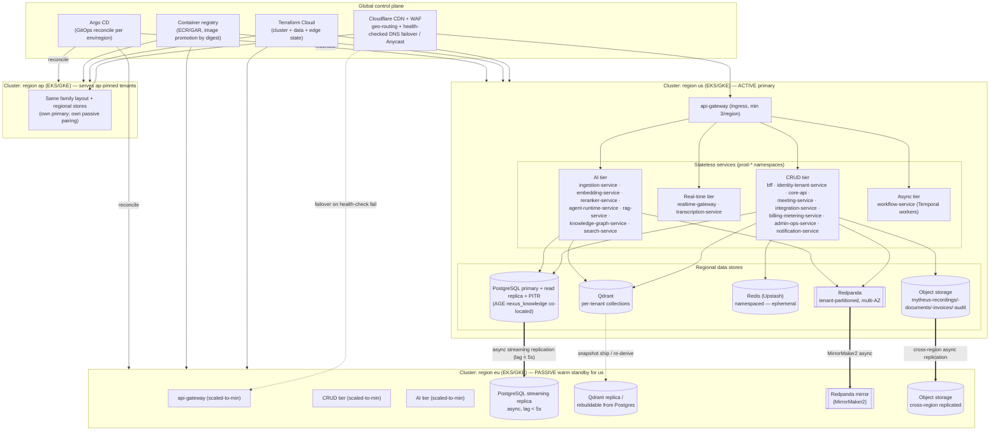
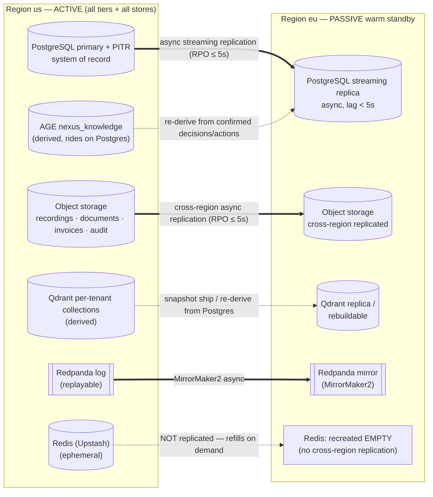
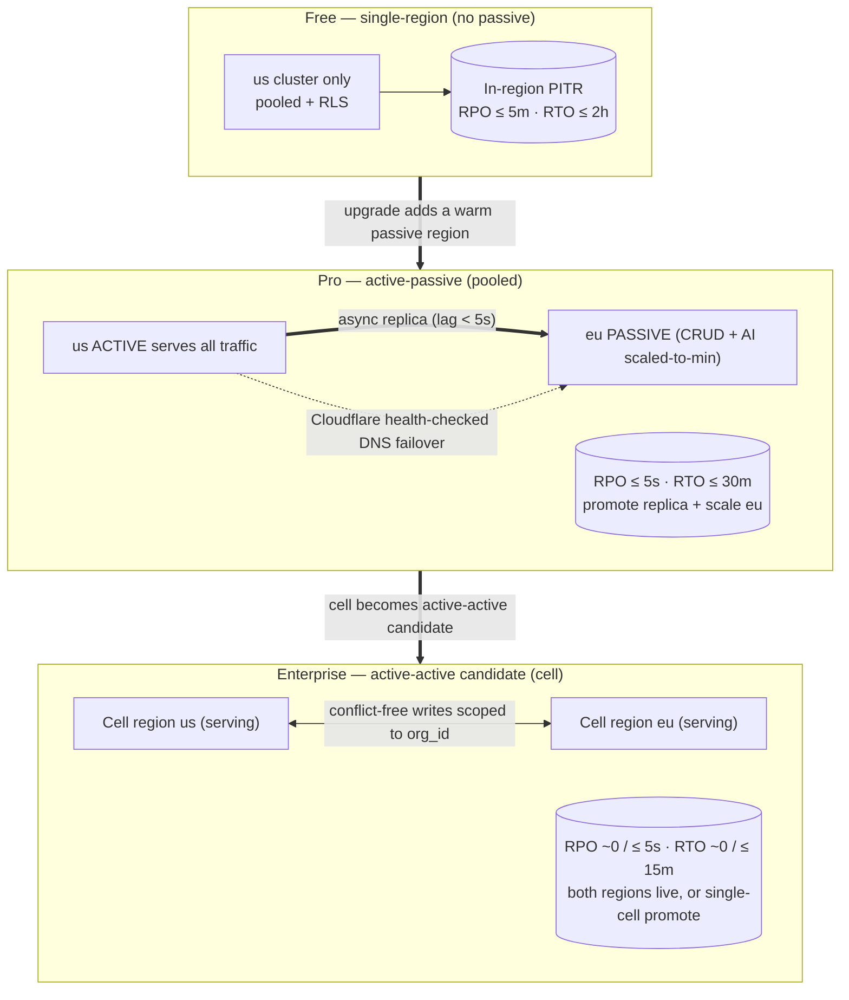

# Deployment & Multi-Region

A diagram-first reference for how NEXUS deploys behind the Cloudflare edge into per-region Kubernetes clusters (`us`/`eu`/`ap`), how each region's stateless services and data stores are placed, how cross-region replication works per store, and how the region posture evolves from active-passive (Pro) to active-active (Enterprise) with health-checked failover.

## Related documents

- [Deployment & Infrastructure](../16-deployment-and-infrastructure.md) — the Kubernetes (EKS/GKE) topology, the region × environment × cell composition, family node pools, GitOps delivery, and the multi-region posture this diagram set illustrates (§2, §12).
- [Reliability & Disaster Recovery](../14-reliability-and-dr.md) — the authoritative active-passive → active-active topology, the asymmetric passive region, per-store backup/replication semantics, and the RPO/RTO ladder (§3, §4).
- [Service Catalog](../_canon/01-service-catalog.md) — the canonical, frozen service names and the three scaling families (CRUD / real-time / AI) grouped here exactly as named.
- [Canonical Data Model](../_canon/02-data-model.md) — `data_residency.region` (`us`/`eu`/`ap`) that pins both tenant data and compute, and the object-storage buckets.
- [Capacity & Scaling Math](../_canon/05-capacity-math.md) — the per-tier availability SLOs (§11.2) and RPO/RTO budgets these diagrams close against.

---

## 1. Purpose and scope

This document is the **visual reference** for one thing: where every NEXUS workload runs across regions and how the system survives the loss of a region. It does not re-specify the Helm/Argo CD delivery mechanics, the Terraform layout, or the rollout strategy — those live in [Deployment & Infrastructure](../16-deployment-and-infrastructure.md); nor does it re-derive RPO/RTO numbers — those are frozen in [Reliability & DR](../14-reliability-and-dr.md) and imported here by reference. Here the diagrams are authoritative; the prose below is a legend.

Two frozen facts shape everything below:

1. **Region identity is `us` / `eu` / `ap`** — one Kubernetes cluster per region, matching the `data_residency.region` values in the [Data Model](../_canon/02-data-model.md). A tenant's compute runs in the region its data is pinned to ([Deployment §2.1](../16-deployment-and-infrastructure.md)). (`us-east-1` and the like are the underlying *cloud* regions, not the NEXUS region identity.)
2. **Postgres is the system of record; every other store is derived, ephemeral, or a replayable log.** This single fact makes the passive region cheap and asymmetric (§3 below, [Reliability §2](../14-reliability-and-dr.md)).

> [SaaS-scale adjustment] The multi-region story is wholly added vs the PDF, which ran a single application on Railway/Render with no Kubernetes, no Terraform, and no DR posture beyond "Postgres backups/PITR/read replica." Cloudflare edge routing, per-region clusters, the active-passive → active-active evolution, and Cloudflare health-checked failover are SaaS-scale additions ([Deployment §12](../16-deployment-and-infrastructure.md), [Reliability §3](../14-reliability-and-dr.md)).

---

## 2. Global topology — Cloudflare edge to regional clusters

All external traffic enters through the Cloudflare edge, which geo-routes each tenant to the region its data is pinned to and health-checks each cluster for failover. Every region is a self-contained Kubernetes cluster running the three stateless scaling families plus the region's own data stores. `us` is the active primary; `eu` is its active-passive warm standby; `ap` is a third region serving its own residency-pinned tenants.



`us` runs the full stack across all three families. `eu` is its warm standby: it keeps the CRUD and AI tiers scaled to minimum replicas and holds an async Postgres streaming replica, a Redpanda MirrorMaker2 mirror, and cross-region-replicated object storage. The `ap` cluster is a peer region serving its own residency-pinned tenants with the same internal layout and its own passive pairing.

> [SaaS-scale adjustment] The real-time tier (`realtime-gateway`, `transcription-service`) is deliberately **not** kept warm in the passive region, and Redis is **not** replicated cross-region — both are intentional asymmetries, not omissions. Live meetings are stateful sub-2s connections that cannot be transparently migrated (clients reconnect to the surviving region and the LiveKit room re-establishes there), and Redis is ephemeral by design (cache/pub-sub/queues, never backed up). The passive region optimizes for fast *resumption of new meetings*, not zero-loss in-flight migration ([Reliability §3.1](../14-reliability-and-dr.md), [Reliability §4](../14-reliability-and-dr.md)).

---

## 3. Cross-region replication and the asymmetric passive region

The passive region is not a mirror image of the primary — each store replicates (or doesn't) according to its role. Solid heavy arrows are the durable system-of-record and replayable-log replication paths; dotted arrows are derived stores that re-hydrate rather than stream, and the Cloudflare failover edge.



The load-bearing insight: only **PostgreSQL and object storage** are stores where a replication gap is true data loss, so both carry the strongest mechanisms (streaming replica + PITR; cross-region replication + object-lock). **Qdrant and AGE** are *derived* and rebuildable from Postgres, so they tolerate a higher RPO and recover by snapshot restore or re-derivation. **Redpanda** is a *replayable log* — consumers resume from the last committed offset and the idempotent inbox dedupes redelivery. **Redis** is *ephemeral* and recreated empty in the surviving region ([Reliability §4](../14-reliability-and-dr.md)).

---

## 4. Active-passive → active-active evolution and failover

The region posture is a product-packaging lever bound to the availability tier ([Capacity §11.2](../_canon/05-capacity-math.md)): **Free is single-region, Pro is active-passive, Enterprise (cell-based) is the active-active candidate.** The evolution from active-passive to active-active maps directly onto the Pro → Enterprise tier progression.



Failover from active `us` to passive `eu` (the Pro path) is a controlled sequence, not an automatic per-request swing:

```mermaid
sequenceDiagram
    participant HC as Cloudflare health checks
    participant CP as Control plane (identity-tenant-service)
    participant RA as Region us (failing)
    participant RB as Region eu (standby)
    participant PG as Postgres replica (eu)
    HC->>RA: probe /healthz (every 10s)
    RA--xHC: 3 consecutive failures (~30s)
    HC->>RB: shift DNS / Anycast withdrawal of us
    CP->>PG: promote replica to primary (pg_ctl promote)
    PG-->>CP: writable, last WAL applied (RPO = replication lag ≤ 5s)
    CP->>RB: scale CRUD + AI tiers to serving capacity (KEDA/HPA)
    RB->>RB: replay Redpanda mirror from last committed offset
    RB-->>HC: /healthz green
    Note over RB: New meetings, agents, RAG resume in eu; in-flight meetings reconnect
```

---

## 5. Legend

| Symbol / label | Meaning |
| --- | --- |
| `us` / `eu` / `ap` | The three NEXUS region identities = `data_residency.region`; one Kubernetes (EKS/GKE) cluster each. `us` is the active primary, `eu` its active-passive warm standby, `ap` a residency peer. |
| Cloudflare CDN + WAF | The single global edge: geo-routing to the residency region and health-checked DNS failover / Anycast to the standby. |
| CRUD / Real-time / AI / Async tiers | The four scaling-family groupings of canonical services from the [Service Catalog](../_canon/01-service-catalog.md); each maps to a `prod-{family}` namespace and its own autoscaler signal. |
| `[(...)]` cylinder | A data store (PostgreSQL, Qdrant, Redis (Upstash), object storage). |
| `[[...]]` | Redpanda, the tenant-partitioned, multi-AZ event log. |
| Heavy arrow `==>` | Durable replication of a system-of-record or replayable store (Postgres streaming replica, object-storage cross-region, Redpanda MirrorMaker2). |
| Dotted arrow `-.->` | Cloudflare failover, derived-store re-hydration (Qdrant snapshot/re-derive, AGE re-derive), and the explicitly non-replicated Redis path. |
| "scaled-to-min" | The passive region keeps CRUD + AI warm at minimum replicas (not cold); the real-time tier is intentionally absent there. |
| RPO / RTO | Recovery point / time objectives, frozen per tier in [Reliability §3.3](../14-reliability-and-dr.md); never re-derived here. |

---

## 6. Key topology notes

- **Region pins compute to data.** A tenant's services run in the cluster (`us`/`eu`/`ap`) its `data_residency.region` pins it to ([Deployment §2.1](../16-deployment-and-infrastructure.md)); Cloudflare geo-routing sends each request to that region, satisfying GDPR data residency at the edge before any service is touched.
- **The passive region is deliberately asymmetric.** `eu` keeps only the CRUD and AI tiers warm at minimum replicas; the **real-time tier is not kept warm** (in-flight meetings reconnect to the surviving region and re-establish the LiveKit room) and **Redis is not replicated** (it is ephemeral and refills on demand). Optimizing for fast resumption of *new* meetings avoids synchronous cross-region audio replication that would blow the sub-2s caption budget ([Reliability §3.1](../14-reliability-and-dr.md)).
- **Replication mechanism is per-store, by role.** Postgres uses async streaming replication (lag < 5s), object storage uses cross-region async replication (with object-lock WORM on `mytheus-invoices`/`mytheus-audit-archive`), and Redpanda uses MirrorMaker2. Qdrant and the AGE `nexus_knowledge` graph are *derived* — they ship snapshots or re-derive from Postgres rather than stream — so a complete loss is a recompute event, not data loss ([Reliability §4](../14-reliability-and-dr.md)).
- **RPO/RTO close against the tier's downtime budget.** Free: single-region PITR, RPO ≤ 5m / RTO ≤ 2h (within 99.5% = 216m/mo). Pro: active-passive, RPO ≤ 5s / RTO ≤ 30m (within 99.9% = 43.2m/mo). Enterprise: active-active candidate, RPO ~0–5s / RTO ~0–15m (within 99.95% = 21.6m/mo) ([Reliability §3.3](../14-reliability-and-dr.md), [Capacity §11.2](../_canon/05-capacity-math.md)).
- **Active-passive → active-active is the Pro → Enterprise evolution.** Pro rides a single warm passive region (one failover/month fits the budget); a second failover in a month would breach it, which is precisely the threshold where an Enterprise cell's active-active posture — conflict-free writes scoped to `org_id` across both regions — becomes worth the cost ([Reliability §3.2](../14-reliability-and-dr.md)).
- **Data residency dictates placement, not just routing.** Object-storage buckets (`mytheus-recordings`, `mytheus-documents`, `mytheus-invoices`, `mytheus-audit-archive`, …) and per-tenant Qdrant collections live in the tenant's region; cross-region replicas exist solely for DR, never to serve a tenant from a non-residency region ([Data Model object buckets](../_canon/02-data-model.md), [Deployment §12](../16-deployment-and-infrastructure.md)).