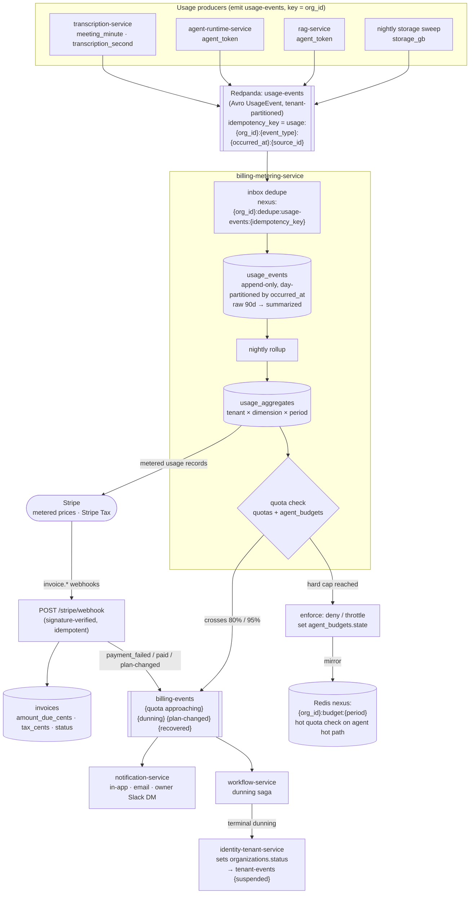
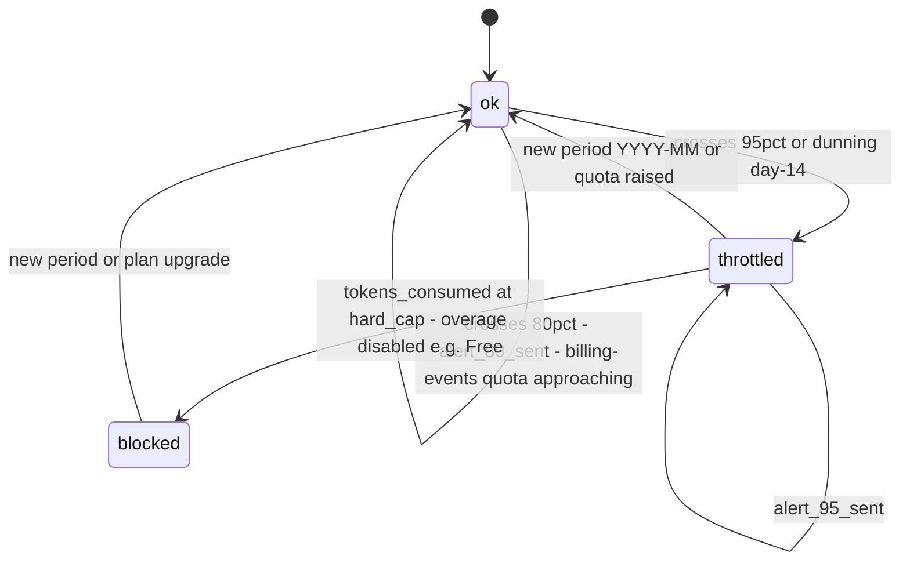
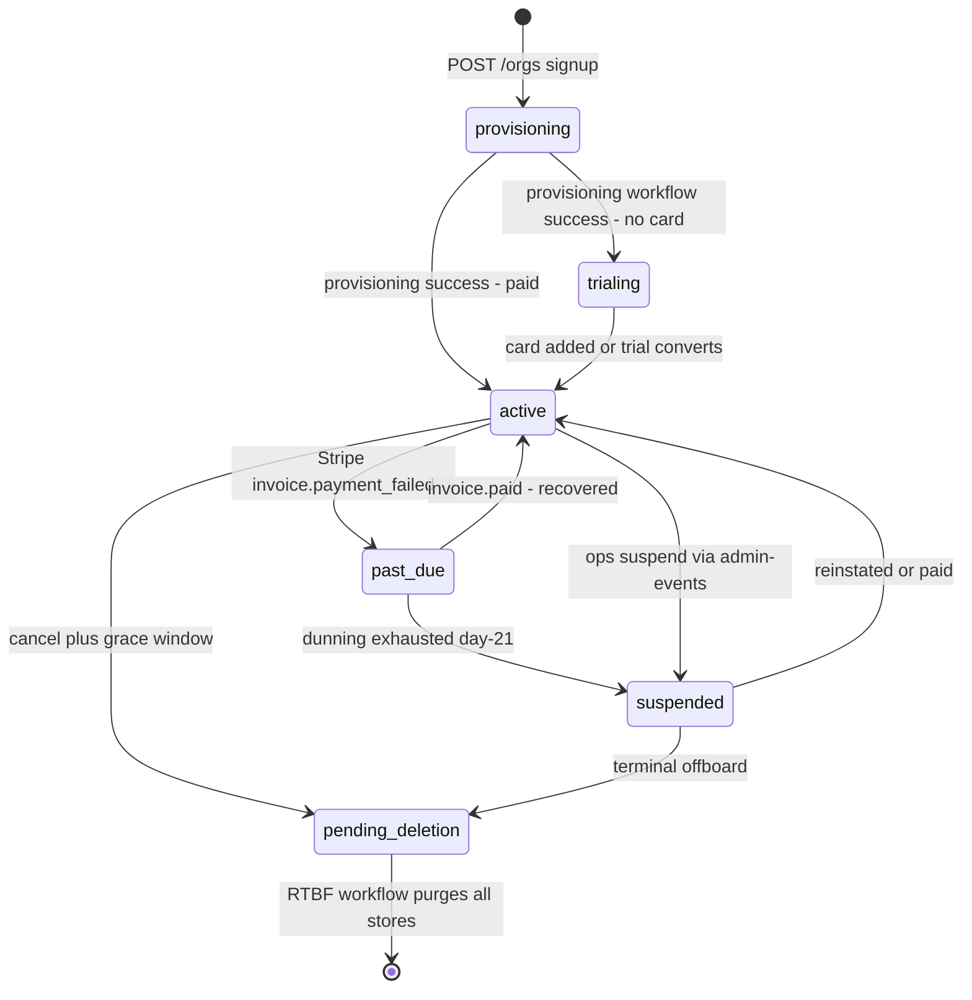
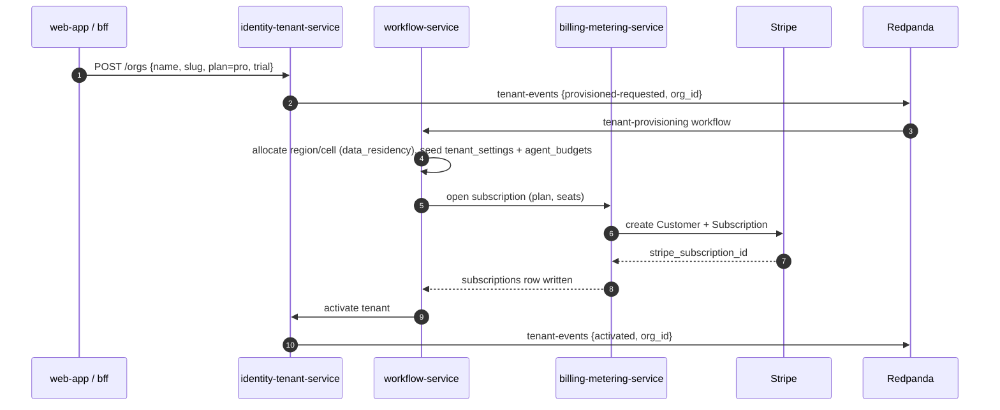
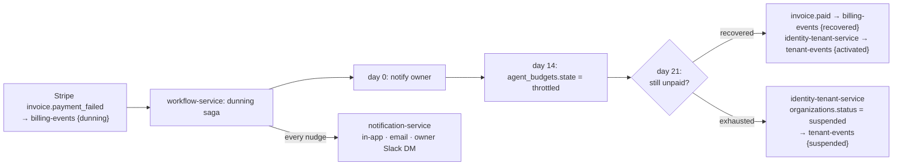

# Billing & Metering Flow

A diagram-first trace of how NEXUS turns raw `usage-events` into metered Stripe bills and enforced per-tenant quotas, and how a tenant moves through its lifecycle — every hop named in canon.

## Related documents

- [SaaS Business Architecture](../18-saas-business-architecture.md) — the full prose specification this diagram set illustrates (tenant state machine, Stripe object mapping, dunning saga, quota semantics, the admin consoles).
- [Service Catalog](../04-service-catalog.md) — canonical ownership of `billing-metering-service`, `identity-tenant-service`, `workflow-service`, `notification-service`, `admin-ops-service`.
- [Service Catalog (canon)](../_canon/01-service-catalog.md) — the single source of truth for service names and the `tenant-events` / `usage-events` / `billing-events` producer→consumer table.
- [Canonical Data Model](../_canon/02-data-model.md) — frozen entity names: `plans`, `subscriptions`, `usage_events`, `usage_aggregates`, `quotas`, `invoices`, `agent_budgets`, `tenant_settings`, `data_residency`.
- [Capacity & Scaling Math](../_canon/05-capacity-math.md) — the metered volumes and cost numbers cited here (`L7`, `D1`, `C2`, `C3`, `C4`).
- [Event-Driven Architecture](../07-event-architecture.md) — `usage-events` / `billing-events` / `tenant-events` / `admin-events` Avro envelopes, partitioning, idempotency keys, outbox/inbox.
- [Locked Tech & Architecture Decisions](../_canon/06-tech-decisions.md) — frozen `usage-events → aggregation → quota enforcement` pipeline, per-tenant token budgets & hard quotas, Stripe.

---

## 1. Purpose and scope

This document is the **visual reference** for two coupled flows that make NEXUS a commercial multi-tenant SaaS:

1. **Metering & billing** — `usage-events` → metering aggregation → quota enforcement, in parallel with Stripe billing.
2. **Tenant lifecycle** — provisioning → active/trialing → past_due → suspended → pending_deletion, driven by API calls and `workflow-service` sagas.

The prose authority is [SaaS Business Architecture](../18-saas-business-architecture.md); here the diagrams are authoritative and the prose is a legend. Every service, entity, topic, and key name is taken verbatim from canon.

> [SaaS-scale adjustment] **The entire subject of this document is a SaaS-scale addition.** The PDF (NEXUS Execution Plan v2.1) had no tenants, no plans, no billing, no metering, and no quotas — its world was a single deployment with a seeder of `2 orgs x 10 users x 5 meetings`. The only cost primitive the PDF carried was a *per-user* LLM token budget with Phase-7 alerts and a Phase-13 ~30% reduction target ([Capacity §10.1 C4](../_canon/05-capacity-math.md)); everything else below is new. Per-callout flags mark only the few places a PDF primitive is reused or extended.

Two facts govern the whole flow and are frozen elsewhere:

- **`tenant-events` has exactly one producer: `identity-tenant-service`** (it owns `organizations.status`). `billing-metering-service` emits only `billing-events`; when a Stripe webhook implies a tenant-status transition, it **calls** `identity-tenant-service`, which performs the status write and emits `tenant-events` ([SaaS Business §4.3](../18-saas-business-architecture.md), [Service Catalog (canon)](../_canon/01-service-catalog.md)).
- **Metering is at-least-once with idempotency.** Every `usage-events` record carries the canonical key `usage:{org_id}:{event_type}:{occurred_at}:{source_id}`; `billing-metering-service` dedupes on the inbox + `nexus:{org_id}:dedupe:usage-events:{idempotency_key}` cache so a redelivery never double-counts ([Event Architecture §6](../07-event-architecture.md)).

---

## 2. End-to-end: usage-events → aggregation → quota enforcement + Stripe billing

This is the primary diagram. Producers emit `usage-events`; `billing-metering-service` ingests, dedupes, aggregates nightly, then forks into the **billing** path (Stripe metered usage records → invoices) and the **enforcement** path (quota check → alerts / throttle / block).

The two forks share one input (`usage_aggregates`) but never share a writer: Stripe owns money and tax; `agent_budgets` / `quotas` own enforcement. The `agent_budgets.tokens_consumed` mirror in Redis (`nexus:{org_id}:budget:{period}`) is what the agent tier reads on the hot path so a quota check is a single Redis read, not a Postgres round-trip ([Data Model §5](../_canon/02-data-model.md)).

> [SaaS-scale adjustment] **`meeting_minute` is metered once per meeting, not per participant.** The diarization design (`meeting_speakers` maps diarized `speaker_id → user_id`) lets one Deepgram stream serve a ~6-person call — a deliberate 6x cost lever ([Capacity §7 D3](../_canon/05-capacity-math.md), "do not do this"). The four `usage_events.event_type` values — `meeting_minute`, `transcription_second`, `agent_token`, `storage_gb` — are frozen in [Data Model §2.2](../_canon/02-data-model.md).

### 2.1 The four metered dimensions

| `usage_events.event_type` | Unit | Emitted by | Drives |
|---|---|---|---|
| `meeting_minute` | minute of meeting (one diarized stream/meeting) | `transcription-service` | minutes quota; Deepgram cost (`D1` = 216M min/mo) |
| `transcription_second` | second of audio transcribed | `transcription-service` | fine-grained Deepgram metering |
| `agent_token` | LLM token consumed (Haiku / Sonnet / Opus) | `agent-runtime-service`, `rag-service` | `agent_budgets` token quota; **94% of variable cost** (`C3`) |
| `storage_gb` | GB-month of recordings / documents / vectors | nightly storage sweep | storage quota; object-bucket lifecycle |

`agent_token` is the load-bearing dimension: at `L7` = ~5.79B LLM calls/month it is 94% of the ~$9.73/MAU/month variable cost (`C2`), so the `agent_budgets` hard cap is the primary margin and R4-cost-bomb backstop ([Capacity §10](../_canon/05-capacity-math.md)).

---

## 3. Quota enforcement state machine (`agent_budgets.state`)

`agent_budgets` carries one row per tenant per `YYYY-MM` with `token_quota`, `tokens_consumed`, `hard_cap`, `alert_80_sent`, `alert_95_sent`, and `state`. Enforcement is **deny-by-default and fail-closed**; behavior degrades gracefully before it blocks.

| `state` | Trigger | Agent-tier behavior |
|---|---|---|
| `ok` | `tokens_consumed < 80% × token_quota` | All seven agents run normally |
| `ok` + `alert_80_sent` | crosses 80% | `billing-events {quota approaching}` → notify owner/admin; **no behavior change** |
| `throttled` | crosses 95%, or dunning day-14 | Route **all** windows to Haiku triage only; suspend Sonnet/Opus extraction and `ProactiveAgent`; `ContextGapAgent` falls through to RAG-only (the PDF-authorized **R6** descope) |
| `blocked` | `tokens_consumed ≥ hard_cap` (Free) | Agent spawns denied; **transcription + captions continue** (durable facts never dropped); UI surfaces upgrade prompt |

> [SaaS-scale adjustment] `agent_budgets` is the per-tenant evolution of the PDF's per-user token budget. The 80%/95% alerts and the hard cap sit **downstream** of the cost-controlled pipeline (relevance pre-gating → windowed batching → tiered routing → prompt caching — [Capacity §8.2](../_canon/05-capacity-math.md)), so even a tenant whose traffic defeats the gating cannot run an unbounded LLM bill. Durable facts — `transcript-chunks`, `decisions`, `actions`, `usage-events` — are **never** shed for quota reasons; only discretionary LLM work degrades.

---

## 4. Tenant lifecycle

A tenant is one customer `organizations` row; `organizations.id` **is** the `org_id` carried by every tenant-scoped row, vector, graph node, event, and cache key. The lifecycle is a state machine owned by `identity-tenant-service`; every transition emits a `tenant-events` record (log-compacted, keyed by `org_id`).

| State | Meaning | Entered by | Access |
|---|---|---|---|
| `provisioning` | Durable saga materializing the tenant substrate | `POST /orgs` | none yet |
| `trialing` | `active` with `subscriptions.trial_ends_at` in future | self-serve onboarding | full Pro access, quota-capped, no card |
| `active` | Fully provisioned and paid (or trialing) | provisioning success / `invoice.paid` | full access within plan quotas |
| `past_due` | Invoice unpaid; dunning saga running | `invoice.payment_failed` | reads retained; agents throttled at grace expiry |
| `suspended` | Manual ops suspend or terminal dunning | `admin-events` / dunning saga | all write + agent access denied; data retained |
| `pending_deletion` | Cancelled past grace, or erasure requested | cancel / RTBF request | export-only, then purge |

### 4.1 Provisioning saga (the substrate is materialized here)

Provisioning is a durable Temporal workflow in `workflow-service` (`tenant-provisioning`, a SaaS-added sibling of the PDF's `MeetingLifecycleWorkflow` / `ActionFollowUpWorkflow`). It is durable because it touches six stores and three external systems (Clerk, Stripe, the chosen DB cell/region) and must be exactly-once-effecting across retries ([SaaS Business §2.3](../18-saas-business-architecture.md)).

### 4.2 Dunning saga (failed payment → recover or suspend)

> [SaaS-scale adjustment] The dunning saga reuses the durable-timer pattern of the PDF's `ActionFollowUpWorkflow` (day-1/3/7 reminders, manager escalation at day 10) but applies it to unpaid invoices (day-0/14/21). It throttles the `agent_budgets.state` at day 14 — spending less on a non-paying tenant — before hard suspension at day 21. All nudges go through `notification-service`; the saga never delivers directly.

---

## 5. Legend

| Symbol / label | Meaning |
| --- | --- |
| `[[ name ]]` (subroutine shape) | A **Redpanda topic** (canonical name). All are tenant-partitioned (`key = org_id`), Avro-serialized, `{topic}-value` subject, BACKWARD compatible. |
| `[( name )]` (cylinder) | A **durable store**: a Postgres table or a Redis key namespace. |
| `([ name ])` (stadium) | An **external system** (Stripe). |
| Plain box | A **microservice** or an internal stage (canonical service names from the [Service Catalog](../04-service-catalog.md)). |
| `usage-events` / `billing-events` / `tenant-events` / `admin-events` | The four control-plane / metering topics this flow uses; all SaaS-scale additions ([Event Architecture §4](../07-event-architecture.md)). |
| `nexus:{org_id}:budget:{period}` | Tenant-namespaced Redis mirror of `agent_budgets.tokens_consumed` for hot-path quota checks. |
| `agent_budgets.state` | The `ok` / `throttled` / `blocked` enforcement state, one row per tenant per `YYYY-MM`. |

---

## 6. Key flow notes

- **One topic in, two forks out.** `usage-events` is the single high-frequency ingest; after dedupe and the nightly rollup into `usage_aggregates`, the data forks into **billing** (Stripe metered usage records → `invoices`) and **enforcement** (`quotas` / `agent_budgets` → alerts/throttle/block). Aggregates — not the raw ~1.7B-row/month firehose — feed both Stripe and the `/usage` API, keeping dashboards fast at `T3`-class volume ([Capacity §4](../_canon/05-capacity-math.md)).
- **`agent_token` is where the money is.** At `L7` = ~5.79B LLM calls/month, `agent_token` is **94% of variable cost** (`C3`); the `agent_budgets` hard cap is therefore the primary margin defense and the billing-safety backstop for **R4** (LLM cost spiral). The Phase-13 ~30% optimization target (`C4`) lowers the bill, but the hard quota is what bounds it.
- **Enforcement degrades, then blocks — durable facts are never shed.** Crossing 95% (or dunning day-14) routes all windows to Haiku-only and drops `ContextGapAgent` to the PDF-authorized RAG-only **R6** descope; only `hard_cap` denies new agent spawns. Transcription, captions, `decisions`, `actions`, and `usage-events` keep flowing — quota pressure only sheds discretionary LLM work.
- **`tenant-events` is single-producer by contract.** `billing-metering-service` never writes `organizations.status`; it emits `billing-events` and **calls** `identity-tenant-service`, which owns the status write and is the sole producer of `tenant-events` (`{activated}`, `{suspended}`, `{pending_deletion}`). This prevents two services racing on tenant state.
- **Tenant deletion is one workflow across six stores.** `pending_deletion` (cancel-past-grace or an explicit right-to-be-forgotten request via `admin-events {erasure requested}`) triggers the single `org_id`-parameterized RTBF Temporal workflow that purges Postgres, Qdrant, AGE `nexus_knowledge`, Redis, and object storage, then appends an RTBF completion record to `audit_logs` ([Data Model §7](../_canon/02-data-model.md)).
- **Everything is idempotent and tenant-keyed.** `usage-events` dedupes on `usage:{org_id}:{event_type}:{occurred_at}:{source_id}`; Stripe webhooks dedupe on the Stripe event id (`nexus:{org_id}:dedupe:stripe:{event_id}`); both are signature- or schema-verified, so at-least-once redelivery never double-counts or double-bills ([Event Architecture §6](../07-event-architecture.md)).
