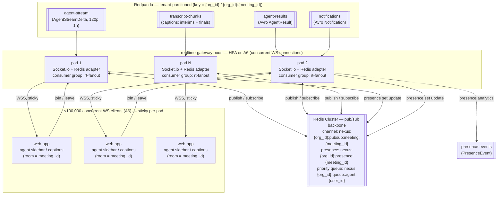
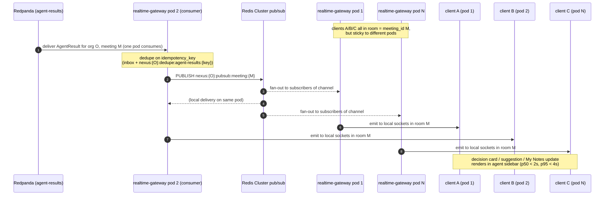
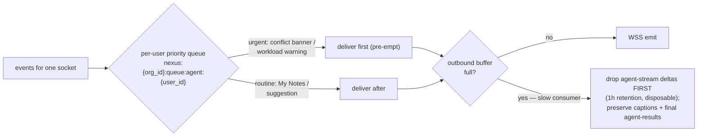

# Real-time Fan-out

A focused diagram surface for how the `realtime-gateway` tier fans streamed agent output, captions, and presence across horizontally-scaled instances to up to 100,000 concurrent WebSocket clients via a Redis Cluster pub/sub backbone and the Socket.io adapter.

## Related documents

- [Real-time & Transcription](../10-realtime-and-transcription.md) — the authoritative prose spec for `realtime-gateway`, the Redis-cluster pub/sub backbone, sticky-connection/stateless-state model, and the per-path latency budget this diagram visualizes.
- [Event Flow: transcript to agent outputs](05-event-flow-transcript-to-agent.md) — the upstream hot path that produces the `agent-results` / `agent-stream` events fanned out here.
- [Event-Driven Architecture](../07-event-architecture.md) — authority for the `agent-stream`, `agent-results`, `notifications`, and `presence-events` schemas, partition keys, partition counts, and retention.
- [Container Architecture](../03-container-architecture.md) — the C4 L2 view; `realtime-gateway` as an independently-scaled container with its own HPA.
- [Multi-Tenancy & Isolation](../06-multi-tenancy.md) — tenant-keyed partitions, `org_id` injection, namespaced Redis channels.
- [Data Architecture](../05-data-architecture.md) — the canonical Redis key namespaces (`nexus:{org_id}:pubsub:meeting:{meeting_id}`, presence set, per-user priority queue).
- [AI Agent Architecture](../08-ai-agent-architecture.md) — the six LangGraph agents that emit the streamed output and priority alerts.
- [Capacity & Scaling Math](../_canon/05-capacity-math.md) — frozen anchors: `A6` 100,000 peak participant connections, `A5` 20,000 peak meetings, `E8` ~1,260 `agent-stream` deltas/meeting.

---

## 1. Scope

This document draws exactly one plane: the **cross-instance fan-out** that turns a single event arriving from Redpanda at one `realtime-gateway` pod into a message delivered to every relevant client socket — even when those sockets are pinned to different pods. The upstream production of `agent-results` and `agent-stream` (the transcript → window → gate → LLM path) is owned by [Event Flow: transcript to agent outputs](05-event-flow-transcript-to-agent.md); the full prose spec of the tier — transport adapter, Deepgram proxy, latency budget — is owned by [Real-time & Transcription](../10-realtime-and-transcription.md). This file is the canonical **fan-out diagram surface** and redefines nothing.

The plane is anchored on `A6` = **100,000 peak concurrent participant connections** ([Capacity §2](../_canon/05-capacity-math.md)), not on `A5` = 20,000 meetings. Connection-count is the autoscaler signal for `realtime-gateway`; meeting-count drives `transcription-service`. They are different anchors on the same real-time scaling family.

> [SaaS-scale adjustment] The PDF ran Socket.io fan-out and the Deepgram proxy inside the single FastAPI application, with a single Redis instance for pub/sub introduced in Phase 11. At `A6` = 100,000 sticky WebSocket connections, the fan-out plane is extracted into its own horizontally-scaled `realtime-gateway` container with a **Redis Cluster** pub/sub backbone whose channels are namespaced `nexus:{org_id}:…` for per-tenant isolation. The diagram below is that production posture.

---

## 2. The fan-out plane (primary diagram)

A connection for meeting `M` may land on **any** `realtime-gateway` pod (sticky for its lifetime), but an `agent-results` / `agent-stream` / caption event for `M` is consumed from the bus by **one** pod. The Socket.io Redis adapter closes that gap: the consuming pod publishes on the canonical channel `nexus:{org_id}:pubsub:meeting:{meeting_id}`, and every pod holding a socket in that room receives it and writes to its local sockets.

> [SaaS-scale adjustment] The pub/sub channel, the live presence set, and the per-user priority queue are all keyed `nexus:{org_id}:…` ([Data Architecture §5](../05-data-architecture.md)). The PDF used unscoped Redis keys on a single instance; tenant-namespaced channels on a Redis Cluster are the isolation and per-tenant-flush mechanism added for SaaS scale.

---

## 3. One event, three pods (sequence)

This trace makes the cross-pod hop explicit: three participants of the same meeting are pinned to three different pods, and a single `agent-results` event reaches all three. The consuming pod does not own all the sockets — Redis Cluster pub/sub does the spanning.

---

## 4. Per-stream backpressure and priority (the shed order)

Each socket has a bounded outbound buffer. When a client consumes slowly, the gateway sheds the lowest-value stream first so interactive surfaces stay live. The per-user priority queue `nexus:{org_id}:queue:agent:{user_id}` lets urgent alerts pre-empt routine note deltas on a congested connection.

> [SaaS-scale adjustment] The shed order — `agent-stream` token deltas dropped before captions or final `agent-results` — mirrors the bus-level load-shedding order in [Event-Driven Architecture §8](../07-event-architecture.md). The PDF's Phase 11 priority queue is preserved; the per-connection backpressure policy and the tenant-namespaced queue key are the SaaS additions. `agent-stream` is the highest-*count* topic (`E8` ≈ 1,260 deltas/meeting) and the lowest-*value*, so it is always shed first.

---

## 5. Legend

| Symbol / convention | Meaning |
|---|---|
| `[[ name ]]` (subroutine shape) | A **Redpanda topic** (canonical name): `agent-stream`, `agent-results`, `notifications`, `transcript-chunks`, `presence-events`. All tenant-partitioned, Avro-serialized, `{topic}-value` subject, BACKWARD compatible. |
| `[[ Redis Cluster … ]]` | The **Redis Cluster pub/sub backbone** — the Socket.io Redis adapter substrate. Channels and keys are namespaced `nexus:{org_id}:…`. |
| Plain box (`pod N`) | A `realtime-gateway` **pod** (canonical service name from the [Service Catalog](../04-service-catalog.md)); all pods run the same code and share the `rt-fanout` consumer group. |
| Solid arrow into a pod | An event consumed from the bus by exactly one pod. |
| `<-->` to Redis Cluster | Bidirectional **publish/subscribe** on `nexus:{org_id}:pubsub:meeting:{meeting_id}`. |
| `-->` pod to client, labeled `WSS, sticky` | The long-lived, connection-pinned WebSocket to a client. |
| Dashed arrow (`-.->`) | Disposable / analytics-only emission (`presence-events` for analytics; deltas shed under backpressure). |
| `room = meeting_id` | Socket.io rooms are keyed by `meeting_id`; the pub/sub channel is keyed `{org_id}:{meeting_id}`. |

---

## 6. Key flow notes

- **The connection is sticky; the state behind it is stateless.** A WebSocket is pinned to its `realtime-gateway` pod for its lifetime (connection-hash / `sid` affinity at the `api-gateway`/ingress), but the pod holds no authoritative state — room membership and fan-out ride Redis Cluster pub/sub, the presence set, and the per-user priority queue. Losing a pod loses only its live sockets, which reconnect elsewhere with no data loss because every durable fact lives in Postgres/Redpanda. See [Real-time & Transcription §4.3](../10-realtime-and-transcription.md).
- **One pod consumes, all pods deliver.** An `agent-results` / `agent-stream` / caption event arrives at a single pod from the bus; that pod publishes once on `nexus:{org_id}:pubsub:meeting:{meeting_id}` and every pod subscribed to that channel emits to its local room sockets. This is the only way to fan out across `A6` = 100,000 connections that are spread over many pods. See [Data Architecture §5](../05-data-architecture.md).
- **Captions and agent output are two SLOs on two paths.** Caption events (`transcript-chunks` interims/finals) target **p95 < 2 s**; agent sidebar output (`agent-results` / `agent-stream`) targets **p50 < 2 s, p95 < 4 s** ([Capacity §11.1](../_canon/05-capacity-math.md)). Both fan out through this same plane, but they are sized and shed differently.
- **`agent-stream` is shed first under congestion.** Token deltas are disposable once rendered (1-hour retention); the UI still receives the final `agent-results` message. The bounded per-socket buffer drops deltas before it drops captions or confirmed agent output — the same load-shedding order as the bus.
- **Urgent alerts pre-empt notes.** The per-user priority queue `nexus:{org_id}:queue:agent:{user_id}` (PDF Phase 11) lets a ProactiveAgent conflict banner or workload warning jump ahead of routine PersonalListenerAgent note deltas on a slow connection.
- **Fan-out delivery is at-least-once, deduped per tenant.** Each pod dedupes consumed events on `idempotency_key` via its inbox table plus the `nexus:{org_id}:dedupe:{topic}:{consumer_group}:{idempotency_key}` Redis cache before publishing, so a redelivered bus event never double-renders in the sidebar. See [Event-Driven Architecture §6–§7](../07-event-architecture.md).

> [SaaS-scale adjustment] Tenant-namespacing every channel and key (`nexus:{org_id}:…`), running the backbone as a Redis Cluster rather than a single instance, and scaling `realtime-gateway` as a standalone container on the `A6` connection anchor are the SaaS-scale changes versus the PDF's single-instance, single-process Phase 11 design. Topic names, the Socket.io room-per-`meeting_id` model, and the streamed-output path are carried over verbatim.
